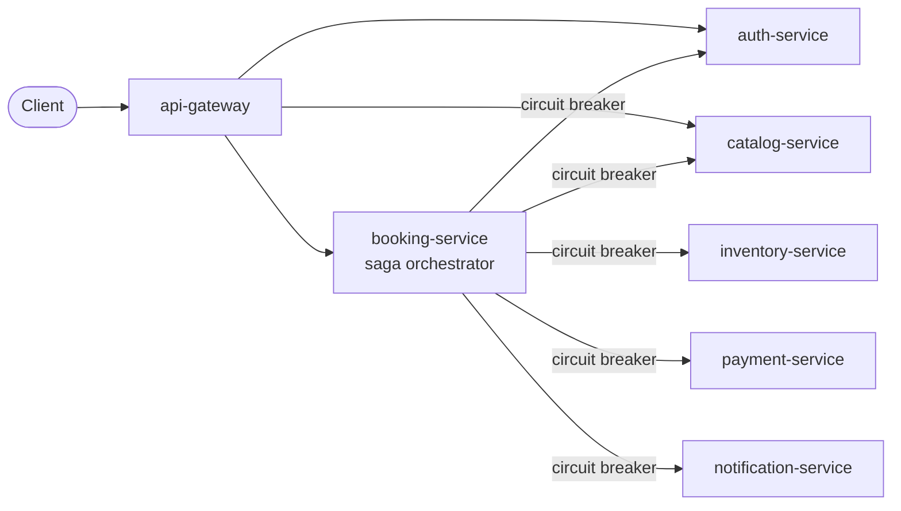

# TicketFlow — Microservices Ticketing Backend

An event-ticketing backend built as independent **Spring Boot** microservices to practise
microservice architecture: database per service, an orchestrated **saga** with compensations,
**Resilience4j circuit breakers** with fallbacks, JWT security and SOLID design.

> Backend only — test it with `./scripts/demo.sh`, Postman or curl.



## Challenge requirements — how each one is met

| Requisito (do guia) | Where it is met |
|---|---|
| **No mínimo 4 microsserviços independentes**, cada um com seu próprio domínio de dados | 6 business services + a gateway. Each one is a standalone Maven project with its own database and no shared code ([ADR 0001](docs/adr/0001-ticketing-domain-and-service-split.md), [ADR 0005](docs/adr/0005-no-shared-libraries.md)) |
| **Tabelas isoladas por serviço**, sem relacionamento entre domínios diferentes | Stronger than required: a separate **database and user per service** (`auth_db`, `inventory_db`, `payment_db`, `booking_db` in PostgreSQL; `catalog_db`, `notification_db` in MongoDB). References to other domains are plain id columns, never foreign keys ([ADR 0002](docs/adr/0002-database-per-service.md)). Verified by `./scripts/check-db-isolation.sh`: each login opens only its own database |
| **Circuit Breaker com método de fallback** | Every call from booking-service to another service: `@CircuitBreaker(name = …, fallbackMethod = …)` in [`booking-service/…/infrastructure/client/`](booking-service/src/main/java/com/ticketflow/booking/infrastructure/client/), 7 breakers in total ([resilience.md](docs/resilience.md)). Proven by `CircuitBreakerIntegrationTest` (OPEN → fail fast → HALF_OPEN → CLOSED) and live by `./scripts/demo.sh` |
| **Fluxo de negócio que passa por todos os microsserviços** | Create booking: gateway → booking → auth → catalog → inventory → payment → inventory → notification, with compensations on failure ([booking-saga.md](docs/booking-saga.md)) |

## Services

| Service | Port | Data store | What it owns |
|---|---|---|---|
| [api-gateway](api-gateway/) | 8080 | — | single entry point, edge JWT check, request ids |
| [auth-service](auth-service/) | 8081 | PostgreSQL | users, roles, JWT issuing |
| [catalog-service](catalog-service/) | 8082 | MongoDB + Redis | events, venues, sectors, prices (cached) |
| [inventory-service](inventory-service/) | 8083 | PostgreSQL | seats and reservations — never oversold |
| [payment-service](payment-service/) | 8084 | PostgreSQL | simulated charges and refunds, chaos mode |
| [notification-service](notification-service/) | 8085 | MongoDB | simulated e-mails, never sent twice |
| [booking-service](booking-service/) | 8086 | PostgreSQL | bookings, the saga, circuit breakers, recovery job |

## Highlights

- **Saga with compensations** — every step committed before the next call; refund and release
  run when a later step fails; a recovery job finishes undo steps that couldn't run, rolls back
  sagas interrupted by a crash, and resends pending notifications.
- **Circuit breakers that know business from failure** — a declined card or a sold-out sector is
  an answer, not a failure; only 5xx, timeouts and connection errors open a circuit. Compensations
  have breakers of their own, so failing charges can't block refunds.
- **Idempotency everywhere** — every saga call is keyed by booking id and safe to retry: no double
  holds, no double charges (one gateway call even for 20 parallel retries), no duplicate e-mails.
- **Concurrency proven by tests** — 50 buyers for the last 10 seats: exactly 10 succeed. A refund
  that overtakes a slow in-flight charge voids it.
- **Documented reasoning** — a design doc with diagrams for every service, and
  [ADRs](docs/adr/) for the decisions.

## Tech stack

- Java 21, Spring Boot 4.1, Spring Cloud 2025.1, Maven
- Spring Web MVC, Spring Data JPA, Spring Data MongoDB, Spring Data Redis, Spring Cache
- Spring Security (OAuth2 resource server, JWT HS256)
- Spring Cloud Gateway Server Web MVC
- Resilience4j (circuit breaker + fallback method)
- PostgreSQL 17 + Flyway, MongoDB 8, Redis 8
- JUnit 5, Mockito, Testcontainers, WireMock, Awaitility
- Docker, Docker Compose, GitHub Actions

## Running locally

Requires Docker. Optionally copy `.env.example` to `.env` to change secrets.

```bash
docker compose up -d --build
./scripts/demo.sh
```

Everything is reached through the gateway at `http://localhost:8080`. The demo creates sample data,
then runs a confirmed booking, a sold-out sector, a declined card, a booking with
notification-service stopped, and payment chaos that takes the circuit breaker through OPEN →
HALF_OPEN → CLOSED. It finishes with a cancellation.

## Tests

Each service is tested on its own (Docker must be running for the Testcontainers tests):

```bash
cd booking-service && ./mvnw test
```

GitHub Actions runs every service's tests on each push ([`.github/workflows/ci.yml`](.github/workflows/ci.yml)).

## Documentation

- [Architecture overview](docs/architecture.md) — services, diagram, communication and data rules
- [Booking saga](docs/booking-saga.md) — the flow that crosses every service, compensations, state machines
- [Resilience](docs/resilience.md) — circuit breakers, fallbacks, chaos demo
- [Architecture Decision Records](docs/adr/)
- [Future features](docs/future-features.md) — messaging, observability, Keycloak, and more

Each service also has its own `docs/design.md` with its internal design.

## Repository layout

```
├── docs/                 # macro view: architecture, saga, resilience, ADRs
├── infra/                # database init scripts (one database + user per service)
├── scripts/              # seed.sh (sample data), demo.sh (end-to-end demo)
├── <service>/            # one standalone Maven project per service, each with its own docs/
└── docker-compose.yml    # the whole system locally
```
