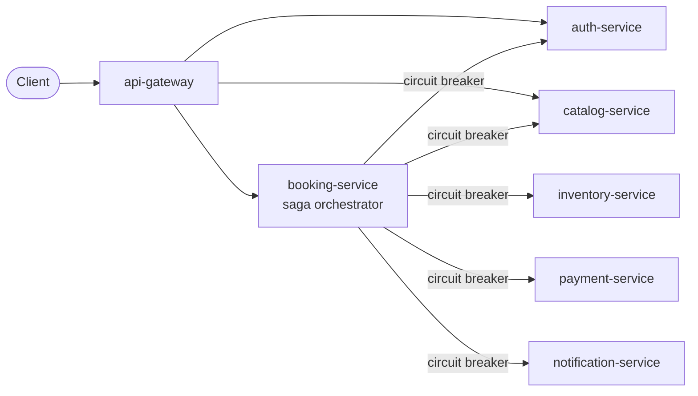

**English** | [Português (Brasil)](README.pt-BR.md)

# TicketFlow — Microservices Ticketing Backend

## Context

Selling event tickets touches several concerns: identity, the catalog, seats, payment and
e-mails. Split into microservices, one sale crosses five services over the network, and any of
them can be slow or down mid-sale. The challenge: at least 4 independent services with isolated
data, a circuit breaker with a fallback method, and one business flow through every service.

## Action

Seven **Spring Boot** services, each a standalone Maven project with its own database. Booking is
an orchestrated **saga**: every step is committed before the next call, and a failure triggers
compensations (refund, release seats). Every outbound call has a **Resilience4j circuit breaker**
with a fallback chosen for what that call means to the business.



## Result

| Requirement (from the challenge brief) | How it is met |
|---|---|
| **At least 4 independent microservices**, each with its own data domain | 6 business services + a gateway, no shared code ([ADR 0001](docs/adr/0001-ticketing-domain-and-service-split.md), [ADR 0005](docs/adr/0005-no-shared-libraries.md)) |
| **Tables isolated per service**, with no relationships between different domains | A separate **database and user per service**; cross-domain references are plain ids, never foreign keys ([ADR 0002](docs/adr/0002-database-per-service.md)). `./scripts/check-db-isolation.sh` proves each login opens only its own database |
| **Circuit breaker with a fallback method** | 7 breakers in [`booking-service/…/infrastructure/client/`](booking-service/src/main/java/com/ticketflow/booking/infrastructure/client/) ([resilience.md](docs/resilience.md)); `CircuitBreakerIntegrationTest` and `./scripts/demo.sh` show OPEN → HALF_OPEN → CLOSED |
| **A business flow that goes through every microservice** | Create booking: gateway → booking → auth → catalog → inventory → payment → inventory → notification ([booking-saga.md](docs/booking-saga.md)) |

Also proven by tests:

- **No overselling:** 50 buyers for the last 10 seats → exactly 10 succeed.
- **No double charge:** 20 identical parallel charges → one call to the payment gateway.
- **No duplicate e-mail:** 10 identical concurrent requests → one e-mail.
- **Business answers don't open circuits:** a declined card or a sold-out sector is an answer;
  only 5xx, timeouts and connection errors count as failures.
- **Nothing is left half-done:** a recovery job finishes pending compensations, rolls back sagas
  interrupted by a crash and resends pending notifications.

## Services

| Service | Port | Data store | Owns |
|---|---|---|---|
| [api-gateway](api-gateway/) | 8080 | — | single entry point, edge JWT check, request ids |
| [auth-service](auth-service/) | 8081 | PostgreSQL | users, roles, JWT issuing |
| [catalog-service](catalog-service/) | 8082 | MongoDB + Redis | events, venues, sectors, prices (cached) |
| [inventory-service](inventory-service/) | 8083 | PostgreSQL | seats and reservations |
| [payment-service](payment-service/) | 8084 | PostgreSQL | simulated charges and refunds, chaos mode |
| [notification-service](notification-service/) | 8085 | MongoDB | simulated e-mails |
| [booking-service](booking-service/) | 8086 | PostgreSQL | bookings, the saga, circuit breakers, recovery job |

## Tech stack

Java 21 · Spring Boot 4.1 · Spring Cloud 2025.1 (Gateway Server Web MVC) · Spring Security (JWT
HS256) · Spring Data JPA / MongoDB / Redis · Resilience4j · PostgreSQL 17 + Flyway · MongoDB 8 ·
Redis 8 · JUnit 5, Mockito, Testcontainers, WireMock, Awaitility · Docker Compose · GitHub Actions

## Run it

Requires Docker. Optionally copy `.env.example` to `.env` to change secrets.

```bash
docker compose up -d --build
./scripts/demo.sh
```

Everything goes through the gateway at `http://localhost:8080`. The demo runs a confirmed
booking, a sold-out sector, a declined card, a booking with notification-service stopped, payment
chaos that takes the circuit breaker through OPEN → HALF_OPEN → CLOSED, and a cancellation.

## Tests

```bash
cd booking-service && ./mvnw test   # Docker must be running for the Testcontainers tests
```

Each service has its own GitHub Actions workflow, run only when that service changes
([`.github/workflows/`](.github/workflows)).

## Documentation

- [Architecture overview](docs/architecture.md) — services, communication and data rules
- [Booking saga](docs/booking-saga.md) — the cross-service flow, compensations, state machines
- [Resilience](docs/resilience.md) — circuit breakers, fallbacks, chaos demo
- [Architecture Decision Records](docs/adr/)
- [Future features](docs/future-features.md) — messaging, observability, Keycloak and more
- Each service: `docs/design.md`

## Repository layout

```
├── docs/                 # macro view: architecture, saga, resilience, ADRs
├── infra/                # database init scripts (one database + user per service)
├── scripts/              # seed.sh (sample data), demo.sh (end-to-end demo)
├── <service>/            # one standalone Maven project per service, each with its own docs/
└── docker-compose.yml    # the whole system locally
```
