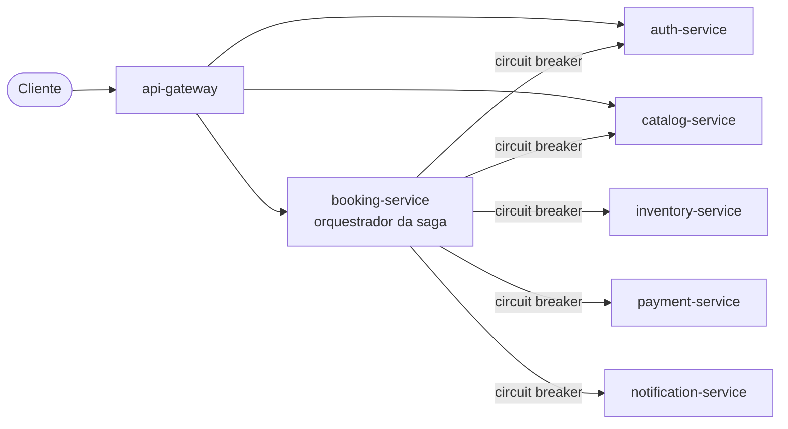

[English](README.md) | **Português (Brasil)**

# TicketFlow — Backend de Ingressos em Microsserviços

> A documentação técnica detalhada (pasta `docs/` e os `docs/design.md` de cada serviço) está em
> inglês.

## Contexto

Vender ingressos envolve várias responsabilidades: identidade, catálogo, assentos, pagamento e
e-mails. Em microsserviços, uma venda atravessa cinco serviços pela rede, e qualquer um deles pode
ficar lento ou cair no meio da venda. O desafio: no mínimo 4 serviços independentes com dados
isolados, um circuit breaker com método de fallback e um fluxo de negócio que passe por todos.

## Ação

Sete serviços **Spring Boot**, cada um um projeto Maven independente com seu próprio banco. A
reserva é uma **saga** orquestrada: cada passo é gravado antes da próxima chamada, e uma falha
dispara compensações (reembolso, liberação de assentos). Toda chamada para outro serviço tem um
**circuit breaker do Resilience4j** com um fallback escolhido pelo que aquela chamada significa
para o negócio.



## Resultado

| Requisito (do guia) | Como é atendido |
|---|---|
| **No mínimo 4 microsserviços independentes**, cada um com seu próprio domínio de dados | 6 serviços de negócio + um gateway, sem código compartilhado ([ADR 0001](docs/adr/0001-ticketing-domain-and-service-split.md), [ADR 0005](docs/adr/0005-no-shared-libraries.md)) |
| **Tabelas isoladas por serviço**, sem relacionamento entre domínios diferentes | Um **banco e um usuário separados por serviço**; referências a outros domínios são apenas ids, nunca chaves estrangeiras ([ADR 0002](docs/adr/0002-database-per-service.md)). O `./scripts/check-db-isolation.sh` prova que cada login abre apenas o próprio banco |
| **Circuit Breaker com método de fallback** | 7 circuit breakers em [`booking-service/…/infrastructure/client/`](booking-service/src/main/java/com/ticketflow/booking/infrastructure/client/) ([resilience.md](docs/resilience.md)); o `CircuitBreakerIntegrationTest` e o `./scripts/demo.sh` mostram OPEN → HALF_OPEN → CLOSED |
| **Fluxo de negócio que passa por todos os microsserviços** | Criar reserva: gateway → booking → auth → catalog → inventory → payment → inventory → notification ([booking-saga.md](docs/booking-saga.md)) |

Também comprovado por testes:

- **Nunca vende a mais:** 50 compradores para os últimos 10 assentos → exatamente 10 conseguem.
- **Nunca cobra em dobro:** 20 cobranças idênticas em paralelo → uma chamada ao gateway de
  pagamento.
- **Nunca envia e-mail duplicado:** 10 requisições idênticas ao mesmo tempo → um e-mail.
- **Respostas de negócio não abrem o circuito:** cartão recusado ou setor esgotado é uma resposta;
  só 5xx, timeouts e erros de conexão contam como falha.
- **Nada fica pela metade:** um job de recuperação termina compensações pendentes, desfaz sagas
  interrompidas por uma queda e reenvia notificações pendentes.

## Serviços

| Serviço | Porta | Armazenamento | Responsável por |
|---|---|---|---|
| [api-gateway](api-gateway/README.pt-BR.md) | 8080 | — | ponto de entrada único, validação do JWT na borda, ids de requisição |
| [auth-service](auth-service/README.pt-BR.md) | 8081 | PostgreSQL | usuários, papéis, emissão de JWT |
| [catalog-service](catalog-service/README.pt-BR.md) | 8082 | MongoDB + Redis | eventos, locais, setores, preços (com cache) |
| [inventory-service](inventory-service/README.pt-BR.md) | 8083 | PostgreSQL | assentos e reservas |
| [payment-service](payment-service/README.pt-BR.md) | 8084 | PostgreSQL | cobranças e reembolsos simulados, modo caos |
| [notification-service](notification-service/README.pt-BR.md) | 8085 | MongoDB | e-mails simulados |
| [booking-service](booking-service/README.pt-BR.md) | 8086 | PostgreSQL | reservas, a saga, os circuit breakers, o job de recuperação |

## Tecnologias

Java 21 · Spring Boot 4.1 · Spring Cloud 2025.1 (Gateway Server Web MVC) · Spring Security (JWT
HS256) · Spring Data JPA / MongoDB / Redis · Resilience4j · PostgreSQL 17 + Flyway · MongoDB 8 ·
Redis 8 · JUnit 5, Mockito, Testcontainers, WireMock, Awaitility · Docker Compose · GitHub Actions

## Como rodar

Requer Docker. Opcionalmente, copie `.env.example` para `.env` para mudar os segredos.

```bash
docker compose up -d --build
./scripts/demo.sh
```

Tudo passa pelo gateway em `http://localhost:8080`. A demo executa uma reserva confirmada, um
setor esgotado, um cartão recusado, uma reserva com o notification-service parado, o modo caos do
pagamento, que leva o circuit breaker por OPEN → HALF_OPEN → CLOSED, e um cancelamento.

## Testes

```bash
cd booking-service && ./mvnw test   # o Docker precisa estar rodando para os testes com Testcontainers
```

Cada serviço tem seu próprio workflow no GitHub Actions, que roda só quando aquele serviço muda
([`.github/workflows/`](.github/workflows)).

## Documentação (em inglês)

- [Visão geral da arquitetura](docs/architecture.md) — serviços, comunicação e regras de dados
- [Saga de reserva](docs/booking-saga.md) — o fluxo entre serviços, compensações, máquinas de estado
- [Resiliência](docs/resilience.md) — circuit breakers, fallbacks, demo do modo caos
- [Registros de decisões de arquitetura (ADRs)](docs/adr/)
- [Funcionalidades futuras](docs/future-features.md) — mensageria, observabilidade, Keycloak e mais
- Cada serviço: `docs/design.md`

## Estrutura do repositório

```
├── docs/                 # visão macro: arquitetura, saga, resiliência, ADRs
├── infra/                # scripts de inicialização dos bancos (um banco + um usuário por serviço)
├── scripts/              # seed.sh (dados de exemplo), demo.sh (demo ponta a ponta)
├── <serviço>/            # um projeto Maven independente por serviço, cada um com sua docs/
└── docker-compose.yml    # o sistema inteiro localmente
```
