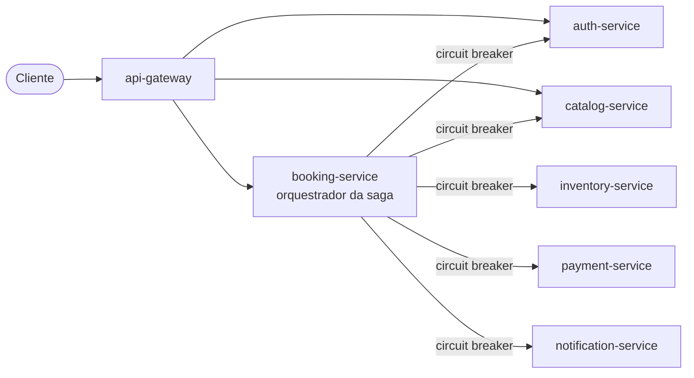

[English](README.md) | **Português (Brasil)**

# TicketFlow — Backend de Ingressos em Microsserviços

Um backend de venda de ingressos para eventos, construído como microsserviços **Spring Boot**
independentes para praticar arquitetura de microsserviços: banco de dados por serviço, uma
**saga** orquestrada com compensações, **circuit breakers do Resilience4j** com fallback,
segurança com JWT e princípios SOLID.

> Apenas backend — teste com `./scripts/demo.sh`, Postman ou curl.
>
> A documentação técnica detalhada (pasta `docs/` e os `docs/design.md` de cada serviço) está em
> inglês.



## Requisitos do desafio — como cada um é atendido

| Requisito (do guia) | Onde é atendido |
|---|---|
| **No mínimo 4 microsserviços independentes**, cada um com seu próprio domínio de dados | 6 serviços de negócio + um gateway. Cada um é um projeto Maven independente, com seu próprio banco de dados e nenhum código compartilhado ([ADR 0001](docs/adr/0001-ticketing-domain-and-service-split.md), [ADR 0005](docs/adr/0005-no-shared-libraries.md)) |
| **Tabelas isoladas por serviço**, sem relacionamento entre domínios diferentes | Mais forte do que o exigido: um **banco de dados e um usuário separados por serviço** (`auth_db`, `inventory_db`, `payment_db`, `booking_db` no PostgreSQL; `catalog_db`, `notification_db` no MongoDB). Referências a outros domínios são apenas colunas com o id, nunca chaves estrangeiras ([ADR 0002](docs/adr/0002-database-per-service.md)). Verificado por `./scripts/check-db-isolation.sh`: cada login abre apenas o seu próprio banco |
| **Circuit Breaker com método de fallback** | Toda chamada do booking-service para outro serviço: `@CircuitBreaker(name = …, fallbackMethod = …)` em [`booking-service/…/infrastructure/client/`](booking-service/src/main/java/com/ticketflow/booking/infrastructure/client/), 7 circuit breakers no total ([resilience.md](docs/resilience.md)). Comprovado pelo `CircuitBreakerIntegrationTest` (OPEN → falha rápida → HALF_OPEN → CLOSED) e ao vivo pelo `./scripts/demo.sh` |
| **Fluxo de negócio que passa por todos os microsserviços** | Criar reserva: gateway → booking → auth → catalog → inventory → payment → inventory → notification, com compensações em caso de falha ([booking-saga.md](docs/booking-saga.md)) |

## Serviços

| Serviço | Porta | Armazenamento | Do que é dono |
|---|---|---|---|
| [api-gateway](api-gateway/README.pt-BR.md) | 8080 | — | ponto de entrada único, validação do JWT na borda, ids de requisição |
| [auth-service](auth-service/README.pt-BR.md) | 8081 | PostgreSQL | usuários, papéis, emissão de JWT |
| [catalog-service](catalog-service/README.pt-BR.md) | 8082 | MongoDB + Redis | eventos, locais, setores, preços (com cache) |
| [inventory-service](inventory-service/README.pt-BR.md) | 8083 | PostgreSQL | assentos e reservas — nunca vende mais do que existe |
| [payment-service](payment-service/README.pt-BR.md) | 8084 | PostgreSQL | cobranças e reembolsos simulados, modo caos |
| [notification-service](notification-service/README.pt-BR.md) | 8085 | MongoDB | e-mails simulados, nunca enviados duas vezes |
| [booking-service](booking-service/README.pt-BR.md) | 8086 | PostgreSQL | reservas, a saga, os circuit breakers, o job de recuperação |

## Destaques

- **Saga com compensações** — cada passo é gravado antes da próxima chamada; reembolso e
  liberação de assentos rodam quando um passo posterior falha; um job de recuperação termina os
  desfazimentos que não puderam rodar, desfaz sagas interrompidas por uma queda do serviço e
  reenvia notificações pendentes.
- **Circuit breakers que distinguem resposta de negócio de falha** — um cartão recusado ou um setor
  esgotado é uma resposta, não uma falha; só erros 5xx, timeouts e erros de conexão abrem um
  circuito. As compensações têm circuit breakers próprios, então cobranças falhando não bloqueiam
  reembolsos.
- **Idempotência em tudo** — toda chamada da saga é identificada pelo id da reserva e pode ser
  repetida com segurança: sem assentos presos em dobro, sem cobrança em dobro (uma única chamada
  ao gateway de pagamento mesmo com 20 tentativas em paralelo), sem e-mails duplicados.
- **Concorrência comprovada por testes** — 50 compradores para os últimos 10 assentos: exatamente
  10 conseguem. Um reembolso que chega antes de uma cobrança lenta ainda em andamento a anula.
- **Raciocínio documentado** — um documento de design com diagramas para cada serviço, e
  [ADRs](docs/adr/) para as decisões.

## Tecnologias

- Java 21, Spring Boot 4.1, Spring Cloud 2025.1, Maven
- Spring Web MVC, Spring Data JPA, Spring Data MongoDB, Spring Data Redis, Spring Cache
- Spring Security (OAuth2 resource server, JWT HS256)
- Spring Cloud Gateway Server Web MVC
- Resilience4j (circuit breaker + método de fallback)
- PostgreSQL 17 + Flyway, MongoDB 8, Redis 8
- JUnit 5, Mockito, Testcontainers, WireMock, Awaitility
- Docker, Docker Compose, GitHub Actions

## Rodando localmente

Requer Docker. Opcionalmente, copie `.env.example` para `.env` para mudar os segredos.

```bash
docker compose up -d --build
./scripts/demo.sh
```

Tudo é acessado pelo gateway em `http://localhost:8080`. A demo cria dados de exemplo e então
executa: uma reserva confirmada, um setor esgotado, um cartão recusado, uma reserva com o
notification-service parado, e o modo caos do pagamento, que leva o circuit breaker por OPEN →
HALF_OPEN → CLOSED. Termina com um cancelamento.

## Testes

Cada serviço é testado separadamente (o Docker precisa estar rodando para os testes com
Testcontainers):

```bash
cd booking-service && ./mvnw test
```

O GitHub Actions roda os testes de todos os serviços a cada push ([`.github/workflows/ci.yml`](.github/workflows/ci.yml)).

## Documentação (em inglês)

- [Visão geral da arquitetura](docs/architecture.md) — serviços, diagrama, regras de comunicação e de dados
- [Saga de reserva](docs/booking-saga.md) — o fluxo que passa por todos os serviços, compensações, máquinas de estado
- [Resiliência](docs/resilience.md) — circuit breakers, fallbacks, demo do modo caos
- [Registros de decisões de arquitetura (ADRs)](docs/adr/)
- [Funcionalidades futuras](docs/future-features.md) — mensageria, observabilidade, Keycloak e mais

Cada serviço também tem seu próprio `docs/design.md` com o design interno.

## Estrutura do repositório

```
├── docs/                 # visão macro: arquitetura, saga, resiliência, ADRs
├── infra/                # scripts de inicialização dos bancos (um banco + um usuário por serviço)
├── scripts/              # seed.sh (dados de exemplo), demo.sh (demo ponta a ponta)
├── <serviço>/            # um projeto Maven independente por serviço, cada um com sua docs/
└── docker-compose.yml    # o sistema inteiro localmente
```
