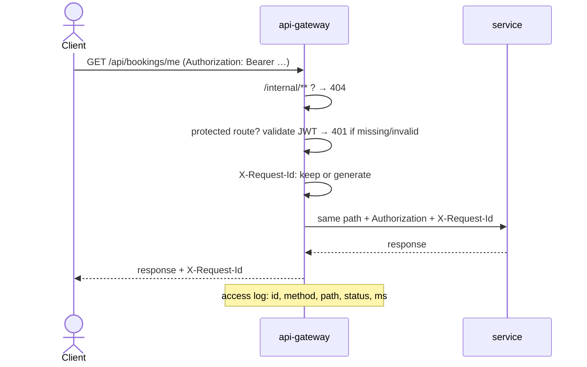
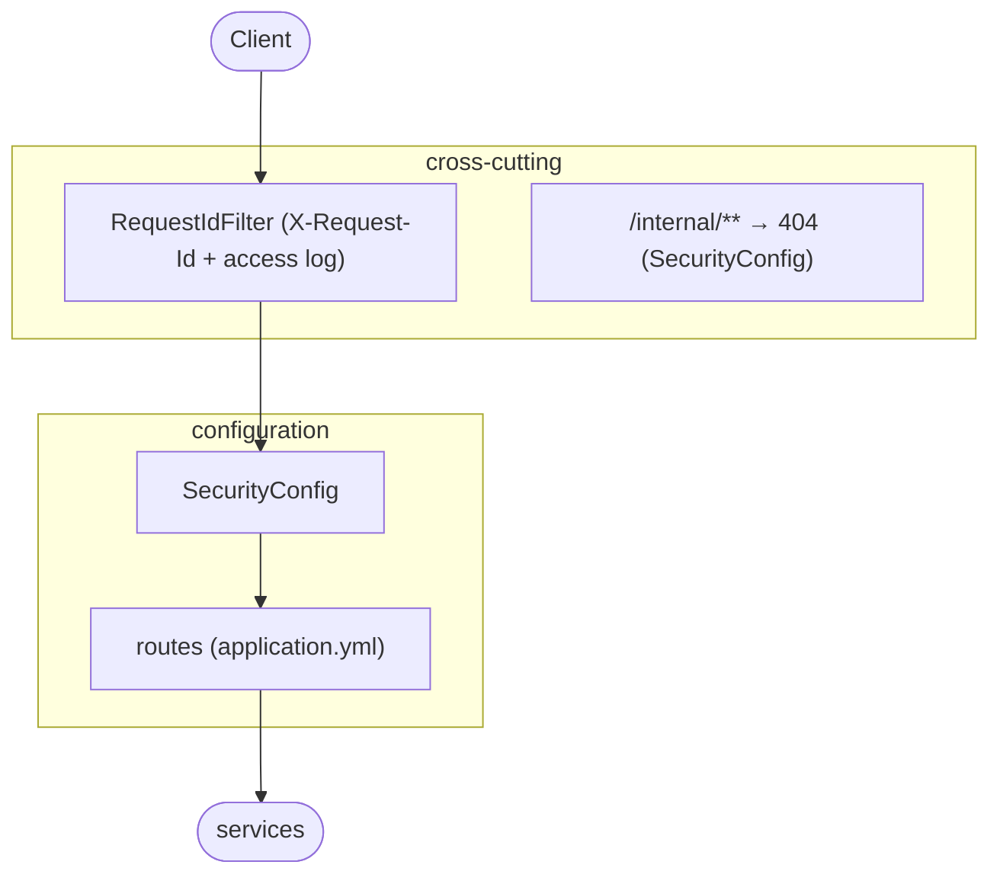

# api-gateway — Design (micro view)

The **single entry point** of TicketFlow. Clients talk only to the gateway on port 8080. It
checks the token, gives each request an id, and forwards it to the service that owns the path.
It owns no data and no business rules.

## Responsibilities

- **Routing:** map each public path to its service.
- **Edge authentication:** reject requests to protected routes without a valid JWT before they
  reach any service (services still validate again: defence in depth).
- **Never expose `/internal/**`:** those endpoints are for service-to-service calls only; the
  gateway answers `404` for them, whatever the token.
- **Request id:** add an `X-Request-Id` header (or keep the client's), pass it to the service,
  return it in the response, and log it on one access line per request.

**Not** its job: fine-grained authorization (roles, ownership). Each service decides that, because
only it knows the rules (e.g. "owner or admin"). The gateway also doesn't retry or apply circuit
breakers. Those live in booking-service, where the business meaning of a failure is known.

## Tech

| Concern | Choice |
|---|---|
| Runtime | Java 21, Spring Boot 4.1.1, Spring Cloud 2025.1.3 |
| Gateway | **Spring Cloud Gateway Server Web MVC** (`spring-cloud-starter-gateway-server-webmvc`) |
| Security | Spring Security resource server, same JWT secret as `auth-service` |
| Tests | JUnit 5, WireMock (fake services), real signed tokens |

### Why the Web MVC gateway and not the reactive one

Spring Cloud Gateway comes in two flavours. The reactive one (WebFlux) is the classic choice for
very high connection counts, but it changes the programming model: reactive security, `Mono`,
different filters. Every other service here is Spring MVC, and the expected traffic is modest. The
Web MVC gateway keeps one model across the project, with the same `SecurityFilterChain` style,
while still giving declarative routes and filters. Virtual threads (Java 21) remove most of the
thread-per-request cost the reactive flavour exists to avoid. They can be switched on if needed.

## Routes

| Path | Service |
|---|---|
| `/api/auth/**`, `/api/users/**` | auth-service |
| `/api/events/**`, `/api/venues/**`, `/api/admin/events/**` | catalog-service |
| `/api/inventory/**` | inventory-service |
| `/api/payments/**` | payment-service |
| `/api/notifications/**`, `/api/admin/notifications/**` | notification-service |
| `/api/bookings/**`, `/api/admin/bookings/**` | booking-service |
| `/internal/**` | **never routed — `404`** |

Paths are forwarded unchanged (`/api/bookings/me` on the gateway is `/api/bookings/me` on
booking-service), so each service's own docs stay valid behind the gateway.

## What is public

Mirrors the services' own rules, so a request is never accepted by one and rejected by the other:

| Public (no token needed) | Everything else |
|---|---|
| `POST /api/auth/register`, `POST /api/auth/login` | valid JWT required → otherwise `401` at the gateway |
| `GET /api/events/**`, `GET /api/venues` | |
| `GET /api/inventory/**` | |
| gateway `GET /actuator/health` | |

Role checks (`ADMIN`) and ownership checks stay in the services, which answer `403` / `404`.

## Request flow

## Timeouts and HTTP version

The gateway talks to services over **HTTP/1.1** (`spring.http.clients.imperative.factory: simple`).
The default JDK client tries an HTTP/2 upgrade on plain connections, and that broke requests with a
body ("RST_STREAM: Stream cancelled"); the tests caught it. Redirects from services are passed to
the client, not followed by the gateway.

The gateway waits up to **15 s** for a service. A booking runs the whole saga before answering:
normally well under a second, but with each downstream call allowed 3 s, a bad case can take
several seconds. The real limit lives in booking-service, per downstream call. If a service is
unreachable, the gateway answers `502` / `504`.

## Internal structure

Package root: `com.ticketflow.gateway`. The routes are configuration, not code. The only Java is
the security rules and the request-id filter.

## Configuration

| Env var | Default (local) | Purpose |
|---|---|---|
| `SERVER_PORT` | `8080` | HTTP port |
| `AUTH_URL` … `BOOKING_URL` | `http://localhost:8081` … `8086` | Where each service is (Compose hostnames in Docker) |
| `JWT_SECRET` | none (dev value in `application-local.yml`) | Token validation |

## Tests

- **Routing (WireMock as every service):** each path reaches the right service with the path,
  query, body, `Authorization` and `X-Request-Id` intact; the service's status and body come back
  unchanged.
- **Security:** public routes pass without a token; protected routes get `401` without one, with a
  forged or expired one, or from another issuer — and the request never reaches the service;
  `/internal/**` is `404` even with a valid token.
- **Request id:** generated when missing, kept when sent, returned in the response.

## Delivered with this service

- `api-gateway/` Maven project and `Dockerfile`, added to `docker-compose.yml`
- `scripts/seed.sh` and `scripts/demo.sh` switched to go **through the gateway** (port 8080), as a
  real client would. Only ops calls (circuit breaker state, chaos switch shortcuts) still use the
  services' own ports.
- The services keep their ports published in Compose for debugging. In production only the
  gateway would be exposed.

## Future

Rate limiting per user (Redis-backed), CORS for a future frontend, and request tracing across
services — see [future features](../../docs/future-features.md).
