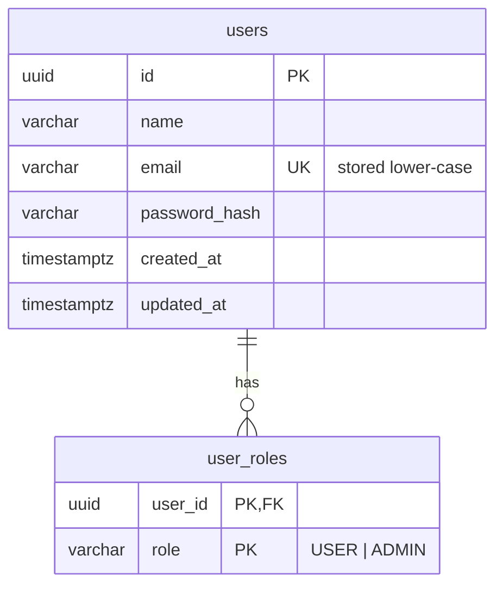
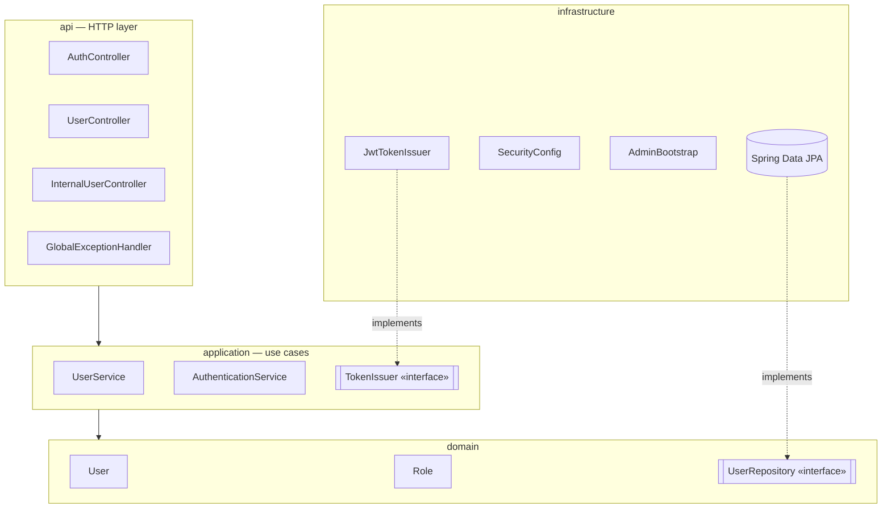
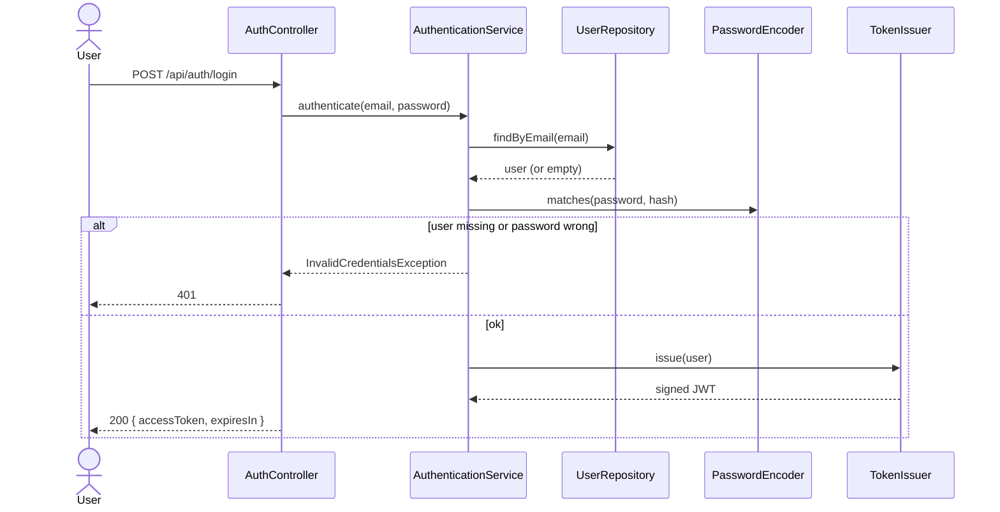

# auth-service — Design (micro view)

Owns **identity**: users, their roles, and the JWTs that every other service trusts.

## Responsibilities

- Register users (default role `USER`).
- Authenticate with e-mail + password and issue a signed JWT.
- Return the current user's profile.
- Provide a user snapshot (name, e-mail) to `booking-service` over an internal endpoint.
- Let an `ADMIN` grant or revoke roles.

**Not** its job: validating tokens for other services (each one validates locally with the
shared secret), sessions, or refresh tokens (see [future features](../../docs/future-features.md)).

## Tech

| Concern | Choice |
|---|---|
| Runtime | Java 21, Spring Boot 4.1.1 |
| Web | Spring Web MVC + Bean Validation |
| Persistence | Spring Data JPA + PostgreSQL `auth_db`, schema via Flyway |
| Passwords | BCrypt (`PasswordEncoder`) |
| Tokens | Spring Security OAuth2 Resource Server + Nimbus `JwtEncoder`/`JwtDecoder`, HS256 |
| Errors | RFC 9457 `ProblemDetail` |
| Tests | JUnit 5, Mockito, `@WebMvcTest`, Testcontainers (PostgreSQL) |

Using Spring Security's built-in JWT support means no third-party JWT library.

## API

| Method | Path | Access | Description |
|---|---|---|---|
| `POST` | `/api/auth/register` | public | Create a user → `201` |
| `POST` | `/api/auth/login` | public | Credentials → JWT |
| `GET` | `/api/auth/me` | authenticated | Current user's profile |
| `PUT` | `/api/users/{id}/roles` | `ADMIN` | Replace a user's roles |
| `GET` | `/internal/users/{id}` | authenticated | Snapshot for the orchestrator (not routed by the gateway) |

### Examples

```http
POST /api/auth/register
{ "name": "Ana Souza", "email": "ana@mail.com", "password": "Str0ngPass!" }

201 Created
{ "id": "6f1c…", "name": "Ana Souza", "email": "ana@mail.com", "roles": ["USER"], "createdAt": "…" }
```

```http
POST /api/auth/login
{ "email": "ana@mail.com", "password": "Str0ngPass!" }

200 OK
{ "accessToken": "eyJhbGciOiJIUzI1NiJ9…", "tokenType": "Bearer", "expiresIn": 3600 }
```

### Errors

| Case | Status |
|---|---|
| Invalid body (blank name, bad e-mail, weak password) | `400` with field errors |
| E-mail already registered | `409` |
| Wrong e-mail or password | `401` (same message for both — never reveal which one was wrong) |
| Missing / invalid / expired token | `401` |
| Valid token, missing role | `403` |
| User not found | `404` |

Password rule: at least 8 characters, with at least one letter and one digit.

## JWT

| Claim | Value |
|---|---|
| `iss` | `ticketflow-auth` |
| `sub` | user id (UUID) |
| `email` | user e-mail |
| `roles` | e.g. `["USER"]` |
| `iat` / `exp` | issued at / expiry (default 1 h) |

Signed with HS256. The secret (≥ 32 bytes) comes from env var `JWT_SECRET`; the same secret is
given to every service that validates tokens.

## Data model (`auth_db`)



The foreign key is inside the same domain, which is fine. No table here references another
service's data.

**First admin:** created at startup from env vars `ADMIN_EMAIL` / `ADMIN_PASSWORD` if no admin
exists yet. This keeps credentials out of migrations and source code.

## Internal structure



Package root: `com.ticketflow.auth`.

**SOLID in practice**
- *Single responsibility:* `AuthenticationService` checks credentials, `UserService` manages
  users, `JwtTokenIssuer` only builds tokens.
- *Dependency inversion:* use cases depend on `TokenIssuer` and `UserRepository` interfaces,
  not on Nimbus or JPA — easy to mock in unit tests and to swap (e.g. for Keycloak later).
- *Interface segregation:* controllers get small request/response records, never the entity.

## Login flow



## Configuration

| Property / env var | Default (local) | Purpose |
|---|---|---|
| `SERVER_PORT` | `8081` | HTTP port |
| `DB_URL` | `jdbc:postgresql://localhost:5432/auth_db` | Database |
| `DB_USERNAME` / `DB_PASSWORD` | `auth_user` / `auth_pass` | Database credentials (local only) |
| `JWT_SECRET` | none — startup fails without it (dev value in `application-local.yml`) | Signing key, ≥ 32 chars |
| `JWT_EXPIRATION` | `1h` | Token lifetime |
| `ADMIN_EMAIL` / `ADMIN_PASSWORD` | none (dev values in `application-local.yml`) | First admin |

- **`local` profile** — run from the IDE against the Postgres started by docker compose; fills in
  dev-only secrets.
- **Docker Compose** — no profile needed; every value comes from environment variables.

## Tests

- **Unit:** `UserService`, `AuthenticationService`, `JwtTokenIssuer` (Mockito).
- **Web slice:** controllers with `@WebMvcTest` — validation, status codes, security rules.
- **Integration:** full context + PostgreSQL in Testcontainers: register → login → `/me` with
  the token.

## Delivered with this service

- `auth-service/` Maven project (with Maven wrapper) and multi-stage `Dockerfile`
- `infra/postgres/init.sql` creating `auth_db` and its user
- Root `docker-compose.yml` with `postgres` + `auth-service`
