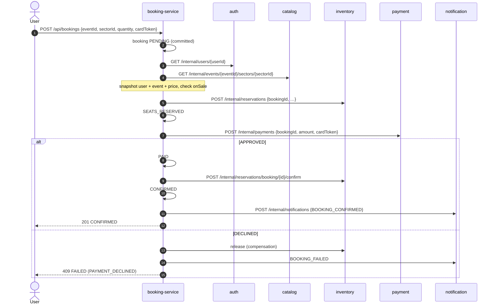
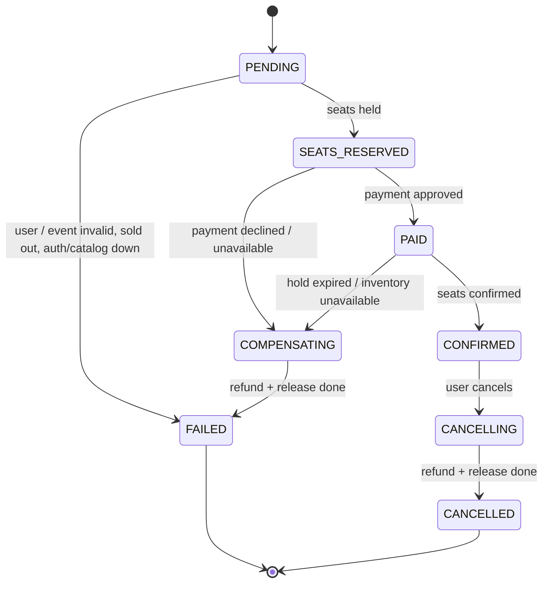
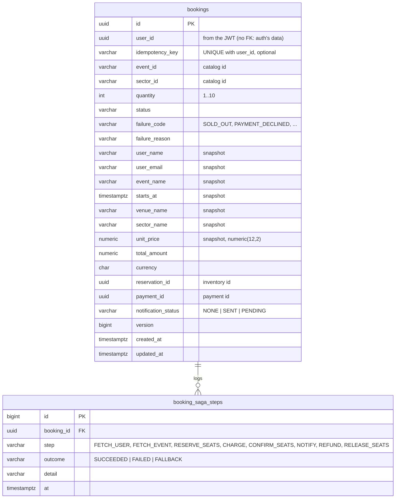
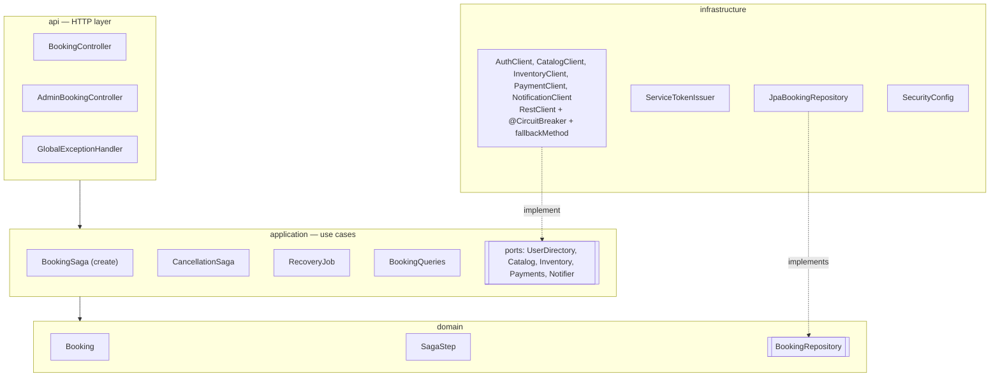

# booking-service — Design (micro view)

Owns **bookings** and **orchestrates the booking saga** — the one business flow that goes through
every other service. Every call it makes to another service is protected by a **Resilience4j
circuit breaker with a fallback method**, and every step it has done can be undone.

This is where the patterns of the project meet: saga + compensation, circuit breaker + fallback,
idempotency, data snapshots, and recovery after a crash.

## Responsibilities

- Create a booking and run the saga: user → catalog → reserve seats → charge → confirm seats →
  notify.
- When a step fails, run the compensations (refund, release seats) and record why it failed.
- Cancel a confirmed booking (reverse saga).
- Keep a **step log** per booking, so anyone can see how far a booking got and why it ended.
- Recover: retry compensations and notifications that couldn't run, and finish bookings left
  half-way by a crash.
- Let users see their bookings; let admins see all.

**Not** its job: owning seats, prices, money or e-mails — it only calls the services that do, and
keeps a **snapshot** of what it needs (user e-mail, event name, unit price) at booking time.

## Tech

| Concern | Choice |
|---|---|
| Runtime | Java 21, Spring Boot 4.1.1 |
| Web | Spring Web MVC + Bean Validation |
| Outbound HTTP | Spring `RestClient`, one client class per downstream service |
| Resilience | **Resilience4j** (`resilience4j-spring-boot4`): `@CircuitBreaker(name, fallbackMethod)` |
| Persistence | Spring Data JPA + PostgreSQL `booking_db`, schema via Flyway |
| Scheduling | `@Scheduled` recovery job |
| Security | Spring Security resource server, same JWT secret as `auth-service` |
| Tests | JUnit 5, Mockito, `@WebMvcTest`, Testcontainers (PostgreSQL), **WireMock** for downstream services |

## The saga



Each step's state is **committed before the next call**. If the service crashes, the database
says exactly how far the booking got, and the recovery job can finish or undo it.

### Step by step, with failures and fallbacks

| # | Step | Business failure (4xx / declined) | Service down / slow / circuit open — **fallback** | Undo needed |
|---|---|---|---|---|
| 1 | get user (auth) | user not found → `FAILED USER_NOT_FOUND` | `FAILED SERVICE_UNAVAILABLE` | nothing |
| 2 | get event + sector (catalog) | not found / not on sale → `FAILED EVENT_NOT_AVAILABLE` | `FAILED SERVICE_UNAVAILABLE` | nothing |
| 3 | reserve seats (inventory) | not enough seats → `FAILED SOLD_OUT` | release-by-booking (the hold *may* exist if the call timed out), `FAILED SERVICE_UNAVAILABLE` | release |
| 4 | charge (payment) | declined → `FAILED PAYMENT_DECLINED` | refund-by-booking (voids a charge still in flight) + release, `FAILED SERVICE_UNAVAILABLE` | refund + release |
| 5 | confirm seats (inventory) | hold expired → refund, `FAILED HOLD_EXPIRED` | refund + release, `FAILED SERVICE_UNAVAILABLE` | refund + release |
| 6 | notify (notification) | — | **notification `PENDING`, booking stays `CONFIRMED`** | nothing |

Refund and release (the undo steps) use their own breakers, `paymentRefunds` and
`inventoryReleases`. When failing charges open `paymentService`, refunds still go through. See
[resilience.md](../../docs/resilience.md).

The fallback **method** is where the decision lives. For example:

```java
@CircuitBreaker(name = "paymentService", fallbackMethod = "chargeUnavailable")
public ChargeResult charge(UUID bookingId, BigDecimal amount, String cardToken) { ... }

private ChargeResult chargeUnavailable(UUID bookingId, BigDecimal amount, String cardToken, Throwable cause) {
    return ChargeResult.unavailable(cause);   // the saga then refunds-by-booking and releases the seats
}
```

### What counts as a failure for a circuit breaker

Only **technical** failures: HTTP `5xx`, connection errors and timeouts (each client has a 3 s read
timeout). Business answers are not failures. They are `4xx` responses mapped to business exceptions
listed in `ignoreExceptions`, or a `201` with status `DECLINED`. A run of sold-out sectors or empty
cards never opens a circuit.

| Setting (per breaker) | Value |
|---|---|
| Sliding window | last 10 calls |
| Minimum calls before evaluating | 5 |
| Failure rate threshold | 50 % |
| Slow call threshold / rate | 2 s / 50 % |
| Wait in OPEN | 10 s |
| Calls allowed in HALF_OPEN | 3 |
| HTTP read timeout | 3 s (plays the role of a time limiter) |

States and recent events are visible at `GET /actuator/circuitbreakers` and
`/actuator/circuitbreakerevents`.

## Booking state machine



`COMPENSATING` and `CANCELLING` are explicit: when an undo step can't run *now* (its service is
down), the booking stays there and the recovery job finishes it later. A booking is never marked
`FAILED` while it still holds the user's money or seats.

## Recovery job

Runs every 30 s, in three small passes:

1. **Unfinished compensations** — bookings in `COMPENSATING` / `CANCELLING`: retry refund and
   release (both idempotent), then move to `FAILED` / `CANCELLED`.
2. **Stuck sagas** — bookings left in `PENDING` / `SEATS_RESERVED` / `PAID` for more than 5 minutes
   (the service crashed mid-saga): compensate them and mark `FAILED SAGA_INTERRUPTED`.
3. **Pending notifications** — bookings whose notification is `PENDING`: send it again
   (notification-service is idempotent, so a retry can never send it twice).

Rows are picked with `FOR UPDATE SKIP LOCKED`, so two instances never work on the same booking.

## Authentication of downstream calls

Downstream services need a token, and they record its subject as the owner of payments and
notifications. The recovery job, though, runs with no user request and therefore no user token.

So booking-service sends an **"on behalf of" token** on every downstream call, signed with the
shared secret: `sub` = the booking's user id, `roles` = `["SERVICE"]`, valid for 60 s. Leaf services
see the right owner, and the job can call them. This is only possible because tokens are HS256 with
a shared secret. Asymmetric keys and an OAuth2 client-credentials flow are listed in
[future features](../../docs/future-features.md).

## Idempotent create

Clients may send an `Idempotency-Key` header with `POST /api/bookings`. A retry with the same key by
the same user returns the existing booking instead of booking again (`UNIQUE (user_id,
idempotency_key)`). Without the header, every POST is a new booking.

## Data model (`booking_db`)



The card token is **not stored**: it is used once for the charge and dropped.

## API

| Method | Path | Access | Description |
|---|---|---|---|
| `POST` | `/api/bookings` | authenticated | Book `{ eventId, sectorId, quantity, cardToken }`, optional `Idempotency-Key` |
| `GET` | `/api/bookings/{id}` | owner or `ADMIN` | Booking with its saga steps |
| `GET` | `/api/bookings/me?page=&size=` | authenticated | Own bookings, newest first |
| `POST` | `/api/bookings/{id}/cancel` | owner | Cancel a confirmed booking before the event starts |
| `GET` | `/api/admin/bookings?status=&page=&size=` | `ADMIN` | All bookings |
| `GET` | `/actuator/circuitbreakers` | public | Circuit breaker states (demo) |

### What the client gets back

The booking row is created before the saga starts. The response always carries the booking, its
`Location`, and an HTTP status that says how it ended:

| Outcome | HTTP | Booking status |
|---|---|---|
| Confirmed (even if the notification is pending) | `201` | `CONFIRMED` |
| Business failure: sold out, declined, not on sale, hold expired | `409` | `FAILED` + `failureCode` |
| A dependency is unavailable / circuit open | `503` | `FAILED` or `COMPENSATING` + `failureCode: SERVICE_UNAVAILABLE` |
| Invalid request (quantity 0, blank ids...) | `400` | — (nothing created) |

Someone else's booking answers `404`, like payment-service.

## Internal structure



Package root: `com.ticketflow.booking`.

**SOLID in practice**
- *Dependency inversion:* the saga only knows the port interfaces (`Inventory.reserve(...)`), never
  HTTP or Resilience4j. The saga's unit tests use simple fakes for every scenario; the circuit
  breakers are tested separately against WireMock.
- *Single responsibility:* each client owns one service's HTTP contract, its error mapping and its
  circuit breaker and fallback; the saga owns the order of steps and the compensation rules.
- *Rich domain:* `Booking` enforces its state machine (`seatsReserved(...)`, `paid(...)`,
  `startCompensation(...)`, `failed(...)`), so an impossible transition can't be written anywhere.

## Configuration

| Env var | Default (local) | Purpose |
|---|---|---|
| `SERVER_PORT` | `8086` | HTTP port |
| `DB_URL` / `DB_USERNAME` / `DB_PASSWORD` | `…/booking_db`, `booking_user` / `booking_pass` | Database |
| `AUTH_URL`, `CATALOG_URL`, `INVENTORY_URL`, `PAYMENT_URL`, `NOTIFICATION_URL` | `http://localhost:8081` … `8085` | Downstream services (Compose hostnames in Docker) |
| `JWT_SECRET` | none (dev value in `application-local.yml`) | Validate user tokens and sign "on behalf of" tokens |

## Tests

- **Saga unit tests (fakes, fixed clock):** happy path; each business failure; each fallback; the
  compensation that runs for each; notification fallback keeps `CONFIRMED`; cancellation;
  idempotent create.
- **Client tests (WireMock + real Resilience4j):** 4xx doesn't count, 5xx and timeouts do; after
  enough failures the circuit **opens** and calls fail fast without touching the server; it goes to
  **half-open** and closes again when the server recovers; each fallback method returns what the
  saga expects.
- **Web slice:** validation, status codes per outcome, owner vs others vs admin.
- **Integration (PostgreSQL in Testcontainers + WireMock):** full saga persisted with its step log;
  recovery job finishes `COMPENSATING` bookings, interrupted sagas and pending notifications.
- **End to end (Docker Compose, all services):** a script that books, sells a sector out, declines a
  card, stops notification-service (booking still confirmed, notification pending), and turns on
  payment chaos to watch the circuit open, half-open and close.

## Delivered with this service

- `booking-service/` Maven project and `Dockerfile`
- `booking_db` in `infra/postgres/init.sql`, service added to `docker-compose.yml`
- `scripts/demo.sh` — the end-to-end and circuit breaker demo
- Updated [booking-saga.md](../../docs/booking-saga.md) and [resilience.md](../../docs/resilience.md):
  `COMPENSATING` / `CANCELLING` states, the release-on-reserve-timeout fallback, the recovery job,
  and the "on behalf of" token
