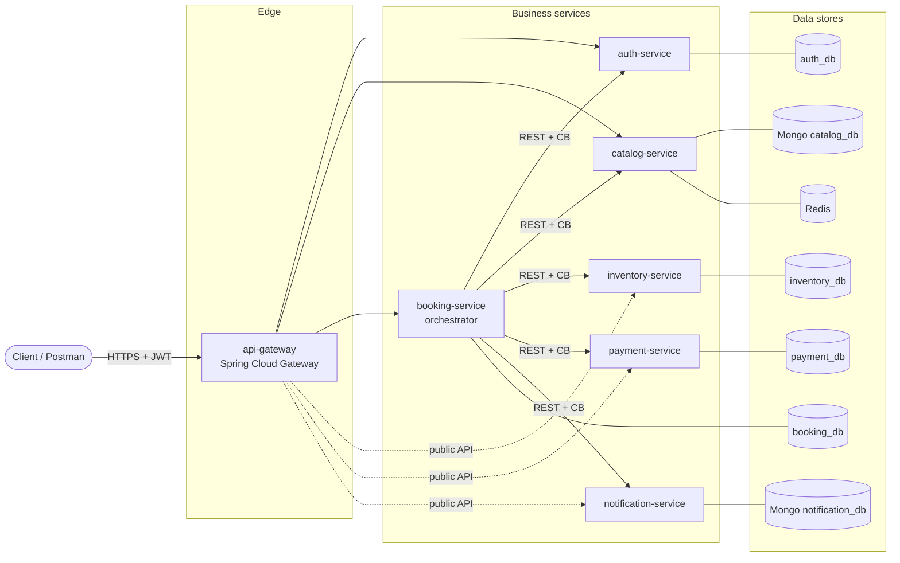

# TicketFlow — Architecture Overview (macro view)

TicketFlow is an event-ticketing backend built as a set of independent Spring Boot
microservices. Users browse events (concerts, games, shows) and book seats. The
booking flow is coordinated by an orchestrator that runs a **saga** across every
service, protected by **Resilience4j circuit breakers** with explicit fallbacks.

## Why this domain

Ticketing has real problems that justify each pattern, instead of using them for show:

| Problem | Pattern it motivates |
|---|---|
| Seats are scarce; two users must never get the last seat | Transactions + locking inside `inventory-service` |
| Payment can fail after seats were already held | Saga with compensation (release seats / refund) |
| A slow or dead service must not freeze the whole booking flow | Circuit Breaker + fallback |
| Event pages are read far more often than they change | Redis cache in `catalog-service` |
| Event details vary per type (lineup vs. teams vs. cast) | Document model (MongoDB) |

## Services

| Service | Port | Responsibility | Data store |
|---|---|---|---|
| `api-gateway` | 8080 | Single entry point, JWT validation, routing | — |
| `auth-service` | 8081 | Users, roles, login, JWT issuing | PostgreSQL `auth_db` |
| `catalog-service` | 8082 | Events, venues, sectors, prices | MongoDB `catalog_db` + Redis cache |
| `inventory-service` | 8083 | Seat availability per sector, reservations (holds) | PostgreSQL `inventory_db` |
| `payment-service` | 8084 | Simulated payments and refunds | PostgreSQL `payment_db` |
| `notification-service` | 8085 | Simulated e-mail notifications + history | MongoDB `notification_db` |
| `booking-service` | 8086 | Bookings + saga orchestration | PostgreSQL `booking_db` |

## Container diagram

`CB` = call wrapped in a Resilience4j circuit breaker (see [resilience.md](resilience.md)).
Dotted lines: the gateway also routes those services' own public endpoints (seat availability,
"my payments", "my notifications", admin tools). The **saga** only ever goes through
booking-service.

## Communication rules

1. **Synchronous REST only** (for now). Messaging is listed in [future-features.md](future-features.md).
2. **Only the orchestrator calls other business services.** Leaf services
   (`auth`, `catalog`, `inventory`, `payment`, `notification`) never call each other.
   This keeps the dependency graph a star, with no cycles.
3. The gateway exposes **public** routes. Endpoints meant only for service-to-service
   calls live under `/internal/**` and are **not** routed by the gateway (it answers `404`).
   See [ADR 0007](adr/0007-web-mvc-gateway.md).
4. Services find each other by Docker Compose hostname (e.g. `http://payment-service:8084`),
   configured per environment in `application.yml` — no service discovery needed
   ([ADR 0006](adr/0006-no-discovery-no-config-server.md)).

## Data ownership

- Each service owns its own database; **no service reads or writes another service's database**.
- **No cross-domain foreign keys.** A booking stores `event_id`, `user_id`, `reservation_id`,
  `payment_id` as plain values.
- When the orchestrator needs data from another domain for later use (user e-mail, event
  name, unit price), it stores a **snapshot** at booking time. If the catalog later changes
  the price, the existing booking keeps the price the user actually paid.

See [ADR 0002](adr/0002-database-per-service.md).

## Security

- `auth-service` registers users, checks credentials and issues signed JWTs (roles: `USER`, `ADMIN`).
- `api-gateway` validates the token on every protected route and rejects invalid ones early.
- Admin routes are enforced in each service's security filter chain, **before** the body is read, so
  a non-admin always gets `403`, never validation errors. `@PreAuthorize` is a second layer.
- Each service validates the token again (defence in depth) and enforces fine-grained rules
  (roles, ownership: someone else's payment or booking answers `404`).
- On downstream calls, booking-service sends a short-lived **"on behalf of" token** for the booking's
  user, so the recovery job, which has no user request, can call services too.

See [ADR 0004](adr/0004-jwt-with-spring-security.md) and
[ADR 0008](adr/0008-on-behalf-of-tokens.md).

## Main business flow

The **Create Booking** saga goes through every service in the architecture —
see [booking-saga.md](booking-saga.md).

## Further reading

- [booking-saga.md](booking-saga.md) — saga steps, compensations, state machines
- [resilience.md](resilience.md) — circuit breakers and fallbacks
- [future-features.md](future-features.md) — what is intentionally out of scope for now
- [adr/](adr/) — Architecture Decision Records
