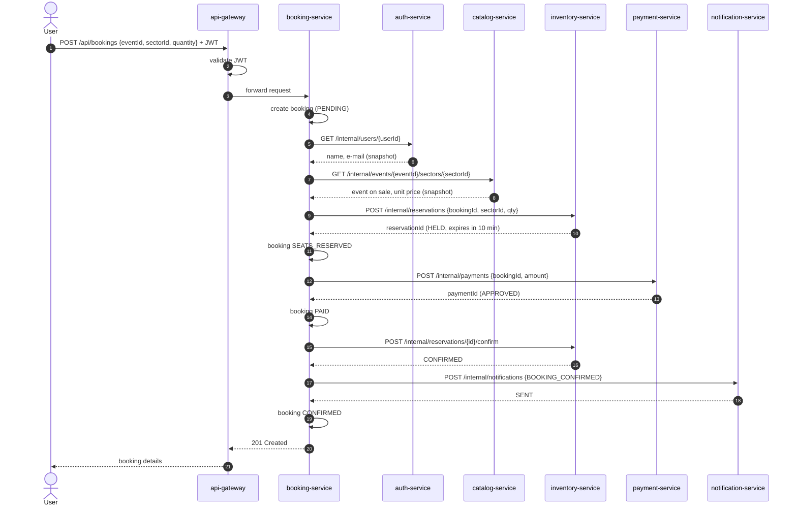
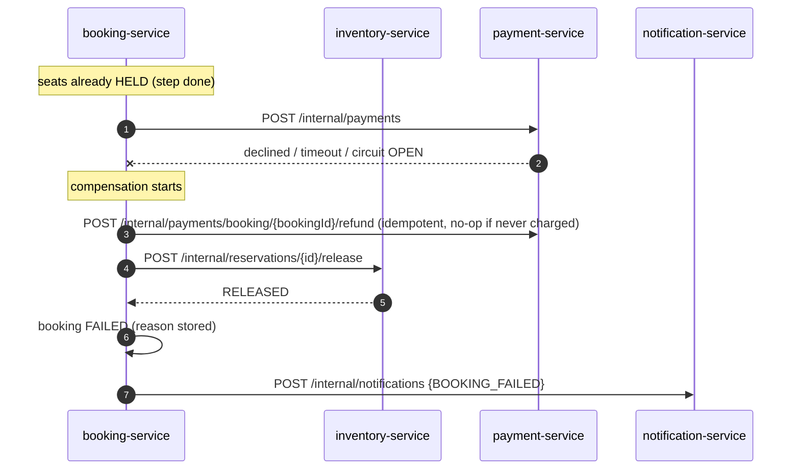
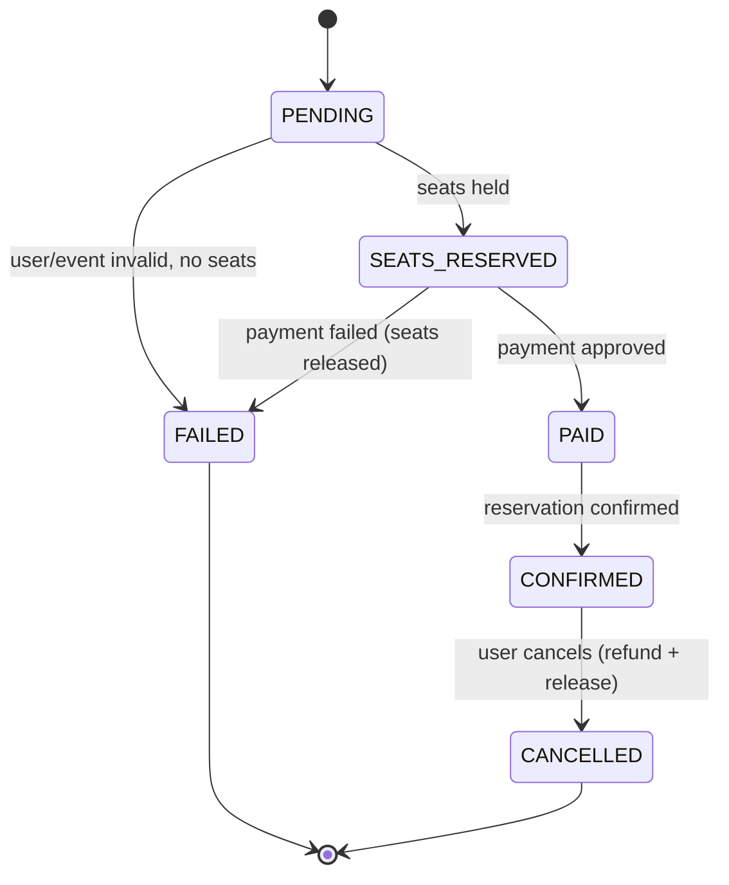
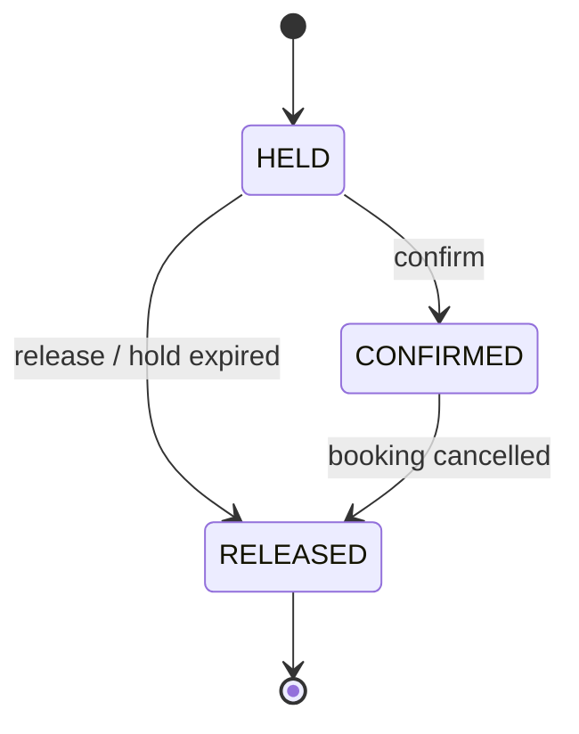

# Booking Saga (orchestration-based)

The booking flow spans several services, each with its own database, so there is no
single ACID transaction. Instead, `booking-service` runs an **orchestrated saga**: it calls
each step in order, records progress in its own database, and when a step fails it runs
**compensating actions** to undo the steps already done.

## Create Booking — happy path

This is the flow that goes through **every service** in the architecture.

## Failure: payment declined or payment-service down → compensation

The refund call matters when the payment call **timed out**: the orchestrator cannot know
whether the charge happened, so it asks for a refund by `bookingId`. The payment service
refunds if a charge exists and does nothing otherwise.

## Failure: notification-service down → fallback, no compensation

A notification is not worth cancelling a paid booking. The circuit breaker fallback stores
the notification on the booking as `PENDING` and the booking still ends as `CONFIRMED`.

## Cancel Booking

Reverse saga, triggered by `POST /api/bookings/{id}/cancel` on a `CONFIRMED` booking:

1. `payment-service` — refund
2. `inventory-service` — release seats
3. `notification-service` — `BOOKING_CANCELLED` (fallback: `PENDING`)
4. booking → `CANCELLED`

## Booking state machine

## Reservation state machine (inventory-service)

## Safety rules

- **Idempotency:** `bookingId` is sent as an idempotency key to `inventory` and `payment`.
  Retrying a step never holds seats twice or charges twice.
- **Hold expiry:** a `HELD` reservation expires after 10 minutes. If the orchestrator crashes
  mid-saga, seats are not locked forever — a scheduled job in `inventory-service` releases them.
- **Saga log:** every step and its result is recorded in `booking_db` (`booking_saga_step`),
  so you can always see how far a booking got and why it failed.
- **Compensations are idempotent** and safe to call more than once.
