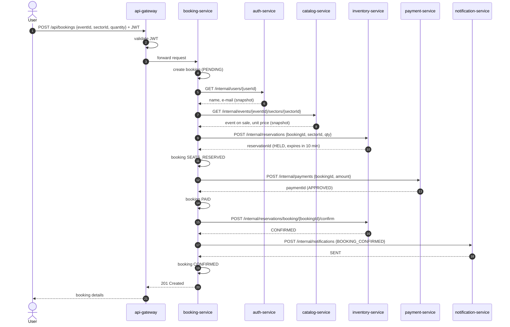
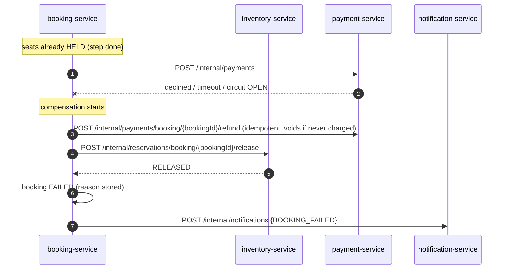
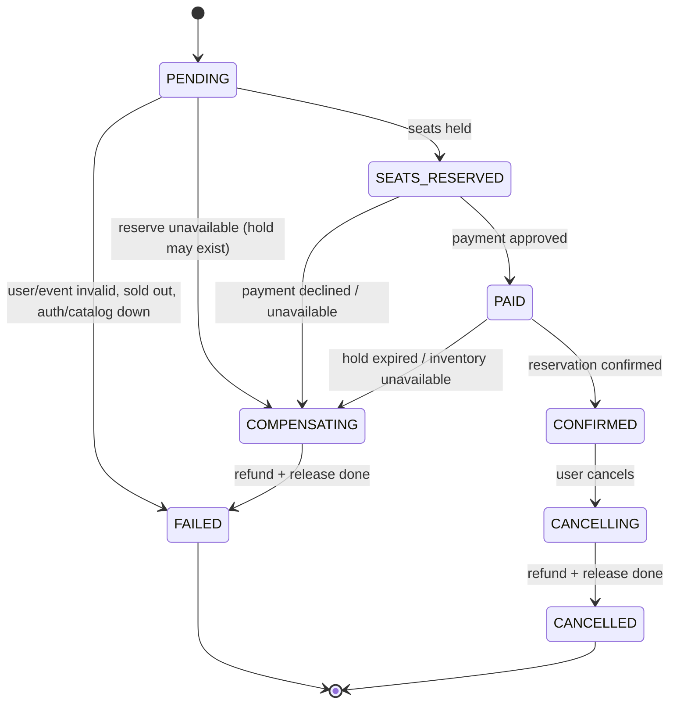
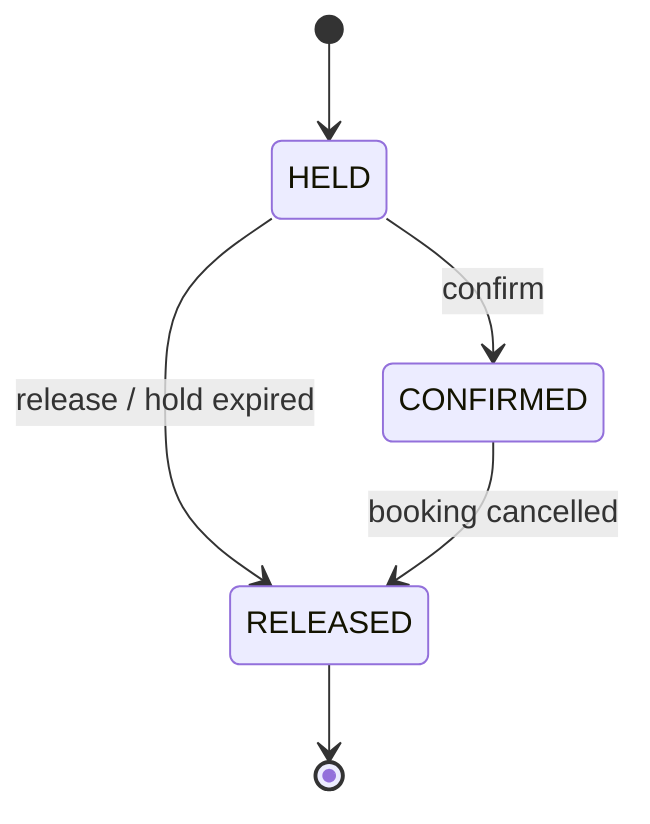

# Booking Saga (orchestration-based)

The booking flow spans several services, each with its own database, so there is no
single ACID transaction. Instead, `booking-service` runs an **orchestrated saga**: it calls
each step in order, records progress in its own database, and when a step fails it runs
**compensating actions** to undo the steps already done.

## Create Booking — happy path

This is the flow that goes through **every service** in the architecture.

## Failure: payment declined or payment-service down → compensation

The refund call matters when the payment call **timed out**: the orchestrator cannot know
whether the charge happened, so it asks for a refund by `bookingId`. The payment service
refunds if a charge exists. If there is none yet, it records the booking as `VOIDED`, so a
charge request that arrives *late* (it was still travelling when the timeout fired) is refused
instead of taking money that would never be returned.

A **declined card** takes the same compensation path (release the seats, booking `FAILED`), but it
is a normal business answer (`201`, status `DECLINED`), not an error: it doesn't count against the
payment circuit breaker.

## Failure: notification-service down → fallback, no compensation

A notification is not worth cancelling a paid booking. The circuit breaker fallback marks the
booking's notification as `PENDING`, the booking still ends `CONFIRMED`, and the recovery job sends
the notification once notification-service is back. notification-service is idempotent by
(booking, type), so the user never gets it twice.

## Failure: an undo step can't run → COMPENSATING, finished later

If payment-service is down when the saga tries to **refund**, the booking does not become `FAILED`.
It stays `COMPENSATING` (or `CANCELLING` for a cancellation) until every undo step has succeeded.
The recovery job in booking-service retries every 30 s. A booking is never marked finished while it
still holds the user's money or seats.

## Cancel Booking

Reverse saga, triggered by `POST /api/bookings/{id}/cancel` on a `CONFIRMED` booking:

1. booking → `CANCELLING` (only before the event starts)
2. `payment-service` — refund
3. `inventory-service` — release seats (`reason=CANCELLED`)
4. booking → `CANCELLED` (or stays `CANCELLING` for the recovery job if 2 or 3 couldn't run)
5. `notification-service` — `BOOKING_CANCELLED` (fallback: `PENDING`)

## Booking state machine

## Reservation state machine (inventory-service)

## Safety rules

- **Idempotency:** `bookingId` is sent as an idempotency key to `inventory` and `payment`.
  Retrying a step never holds seats twice or charges twice.
- **Hold expiry:** a `HELD` reservation expires after 10 minutes. If the orchestrator crashes
  mid-saga, seats are not locked forever — a scheduled job in `inventory-service` releases them.
- **Each step is committed before the next call:** after a crash, the database says exactly how far
  the booking got.
- **Saga log:** every step and its result is recorded in `booking_db` (`booking_saga_steps`) and
  returned with the booking, so you can always see how far a booking got and why it failed.
- **Recovery job (booking-service, every 30 s):** finishes undo steps that couldn't run, rolls back
  sagas interrupted by a crash (left in progress for more than 5 minutes → `FAILED
  SAGA_INTERRUPTED`), and sends `PENDING` notifications. It locks each booking with `SKIP LOCKED`,
  so several instances never work on the same one.
- **"On behalf of" tokens:** booking-service signs a 60-second token for each downstream call, with
  the booking's user as subject. Leaf services record the right owner, and the recovery job, which
  has no user request, can still call them.
- **Idempotent create:** an `Idempotency-Key` header on `POST /api/bookings` makes a client retry
  return the same booking instead of booking twice.
- **Compensations are idempotent** and safe to call more than once.
- **Inventory calls are keyed by `bookingId`**, so the orchestrator can confirm or release even when
  the reserve call timed out and it never learned the reservation id.
- **Hold expired before confirm:** if payment took longer than the hold, confirm returns `409`
  (the seats may already be someone else's). The orchestrator then refunds the payment and the
  booking ends `FAILED`.
