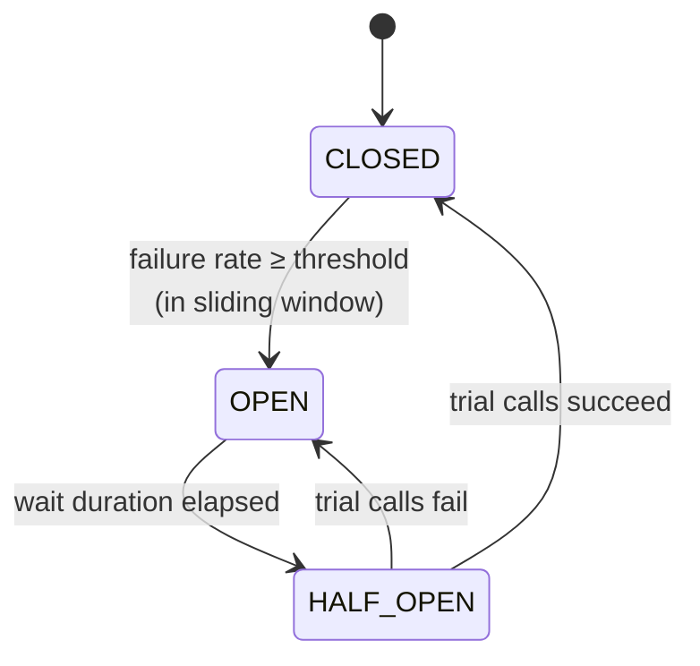

# Resilience — Circuit Breakers and Fallbacks

All service-to-service calls are synchronous REST, so one slow or dead service could block
every booking. Each outbound call from `booking-service` is wrapped in a
**Resilience4j circuit breaker** plus a **time limiter**, and each has a fallback chosen for
what that call means to the business.

## How the circuit breaker behaves



- **CLOSED** — calls go through; failures are counted.
- **OPEN** — calls fail immediately without touching the remote service; the fallback runs.
- **HALF_OPEN** — a few trial calls are allowed to check whether the service recovered.

## Protected calls and their fallbacks

| Call (from booking-service) | Circuit breaker | Fallback | Why |
|---|---|---|---|
| `auth-service` — get user | `authService` | Reject booking: `503 user service unavailable` | We need a valid e-mail snapshot; nothing safe to guess |
| `catalog-service` — get event/sector | `catalogService` | Reject booking: `503 catalog unavailable` | Never sell at an unknown price |
| `inventory-service` — reserve | `inventoryService` | Booking `FAILED`, `503` to client | No seats held yet, nothing to undo |
| `payment-service` — charge | `paymentService` | **Compensate**: refund-by-booking + release seats, booking `FAILED` | Seats are held and must be returned |
| `notification-service` — send | `notificationService` | Store notification as `PENDING`, booking still `CONFIRMED` | A missing e-mail is not worth cancelling a paid booking |

Initial values (tuned per service in `booking-service/src/main/resources/application.yml`):

| Setting | Value |
|---|---|
| Sliding window | 10 calls (count-based) |
| Failure rate threshold | 50 % |
| Slow call threshold | 2 s |
| Wait in OPEN | 10 s |
| Calls allowed in HALF_OPEN | 3 |
| Time limiter timeout | 3 s |

## Demonstrating it: chaos mode in payment-service

`payment-service` has a chaos switch (admin only) to force failures or slowness:

```
POST /api/payments/admin/chaos {"failureRate": 1.0, "latencyMs": 0}
```

Demo script:

1. Turn chaos on at 100 % failure.
2. Create bookings — each one fails, seats are released (compensation).
3. After enough failures the `paymentService` circuit **OPENs**: bookings now fail instantly,
   without waiting for the timeout.
4. Turn chaos off, wait 10 s → **HALF_OPEN** → trial calls succeed → **CLOSED**.

Circuit state is visible at `GET /actuator/circuitbreakers` on `booking-service`.

## Out of scope for now

The guide only requires a circuit breaker. Retry and bulkhead are possible later but not
required; adding retries to a payment call also needs extra care (idempotency is already in
place to make that safe).
