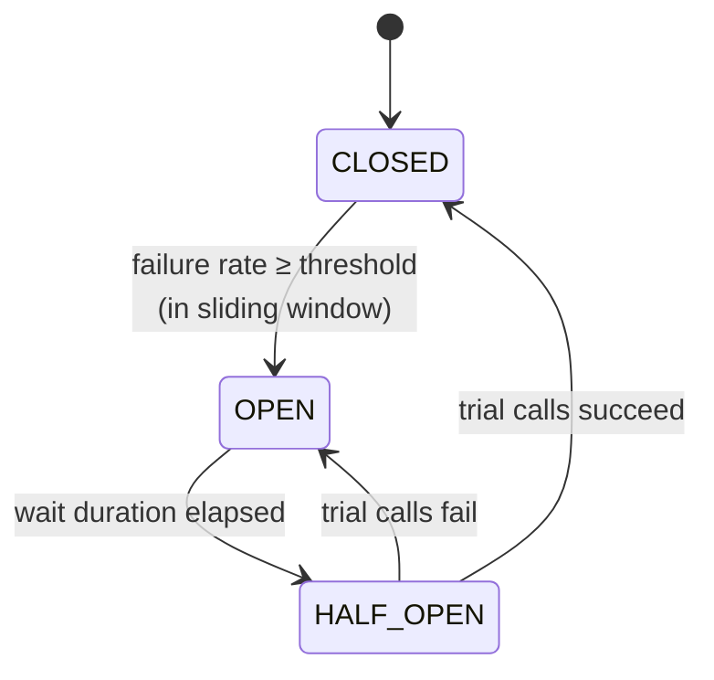

# Resilience — Circuit Breakers and Fallbacks

All service-to-service calls are synchronous REST, so one slow or dead service could block
every booking. Each outbound call from `booking-service` is protected by a **Resilience4j circuit
breaker with a fallback method**, and an HTTP read timeout turns a hanging service into a failure
the breaker can count. Each fallback is chosen for what that call means to the business.

## How the circuit breaker behaves



- **CLOSED** — calls go through; failures are counted.
- **OPEN** — calls fail immediately without touching the remote service; the fallback runs.
- **HALF_OPEN** — a few trial calls are allowed to check whether the service recovered.

## How it is written

Each downstream service has one client class in `booking-service`
(`infrastructure/client/*Client.java`). Every public call is annotated, and its fallback is a method
right next to it:

```java
@CircuitBreaker(name = "paymentService", fallbackMethod = "chargeFallback")
public Charge charge(UUID onBehalfOf, UUID bookingId, BigDecimal amount, String currency, String cardToken) {
    // POST /internal/payments ... 201 APPROVED / DECLINED, anything else is thrown
}

private Charge chargeFallback(UUID onBehalfOf, UUID bookingId, BigDecimal amount, String currency,
        String cardToken, Throwable cause) {
    return Charge.unavailable(unavailable("charge", cause)); // the saga then refunds and releases
}
```

The fallback runs both when the call fails and when the circuit is already OPEN (Resilience4j
passes a `CallNotPermittedException`). The saga only ever sees a result such as `UNAVAILABLE`, never
an HTTP error or a Resilience4j exception.

## Protected calls and their fallbacks

| Call (from booking-service) | Circuit breaker | Fallback → what the saga does | Why |
|---|---|---|---|
| `auth-service` — get user | `authService` | booking `FAILED SERVICE_UNAVAILABLE` (`503`) | We need a valid e-mail snapshot; nothing was done yet |
| `catalog-service` — get event/sector | `catalogService` | booking `FAILED SERVICE_UNAVAILABLE` (`503`) | Never sell at a price we couldn't check |
| `inventory-service` — reserve | `inventoryService` | **release by booking id**, then `FAILED` (`503`) | A timed-out call may still have held the seats |
| `payment-service` — charge | `paymentService` | **refund by booking id + release seats**, then `FAILED` (`503`) | We don't know if the card was charged; refund also voids a charge still in flight |
| `inventory-service` — confirm | `inventoryService` | **refund + release**, then `FAILED` (`503`) | Money is taken but the seats can't be made permanent |
| `notification-service` — send | `notificationService` | notification `PENDING`, booking stays **`CONFIRMED`** (`201`) | A missing e-mail is not worth cancelling a paid booking |
| `payment-service` — refund | `paymentRefunds` | booking stays `COMPENSATING` / `CANCELLING`; the recovery job retries | Never mark a booking finished while it still holds money or seats |
| `inventory-service` — release | `inventoryReleases` | same as refund | same |

**Compensations have breakers of their own.** The first end-to-end demo showed why: with charge and
refund sharing `paymentService`, payment chaos opened the circuit on charges, and then the
**refunds** were rejected too, although they worked. Bookings were left `COMPENSATING` until the
recovery job came by. With separate breakers, failing charges or reservations never block the
undo. If the whole service is down, both breakers open on their own anyway.

## What counts as a failure

Only **technical** failures: HTTP `5xx`, connection errors, timeouts, and answers the client
doesn't expect. Business answers are returned as normal results and never count:

- a declined card is `201` with status `DECLINED`;
- "not enough seats" is a `409` that the inventory client maps to `NOT_ENOUGH_SEATS`;
- "event not found" is a `404` that the catalog client maps to `NOT_FOUND`.

Otherwise a run of users with empty cards, or a popular sector selling out, would open a circuit
and block everyone.

## Settings

Shared by all seven breakers (`booking-service/src/main/resources/application.yml`):

| Setting | Value |
|---|---|
| Sliding window | last 10 calls (count-based) |
| Minimum calls before evaluating | 5 |
| Failure rate threshold | 50 % |
| Slow call threshold / rate | 2 s / 50 % |
| Wait in OPEN | 10 s, then automatic move to HALF_OPEN |
| Calls allowed in HALF_OPEN | 3 |
| HTTP connect / read timeout | 1 s / 3 s (the read timeout plays the role of a time limiter) |

An open circuit does **not** make booking-service "not ready". Its readiness probe only checks
its own database: an open circuit means the system is working as designed.

## Demonstrating it: chaos mode in payment-service

`payment-service` has a chaos switch (admin only) to force failures or slowness:

```
PUT /api/payments/admin/chaos {"failureRate": 1.0, "latencyMs": 0}
DELETE /api/payments/admin/chaos        # back to normal
```

Chaos only affects **charges** (refunds stay reliable, so compensation keeps working).

`./scripts/demo.sh` runs the whole story:

1. Turn chaos on at 100 % failure.
2. Book 5 times: each payment fails, the fallback runs, and seats are released (compensation).
3. The `paymentService` circuit is now **OPEN**: the next booking doesn't even try the payment call.
   It fails in milliseconds, and its seats are released.
4. Turn chaos off, wait 10 s → **HALF_OPEN** → 3 trial bookings succeed → **CLOSED**.

Circuit state is visible at `GET /actuator/circuitbreakers` and recent transitions at
`GET /actuator/circuitbreakerevents` on `booking-service`.

The same cycle is covered by `CircuitBreakerIntegrationTest`, against WireMock.

## Out of scope for now

The guide only requires a circuit breaker. Retry and bulkhead are possible later but not
required. Retrying a charge would be safe, since every call is idempotent by booking id.
