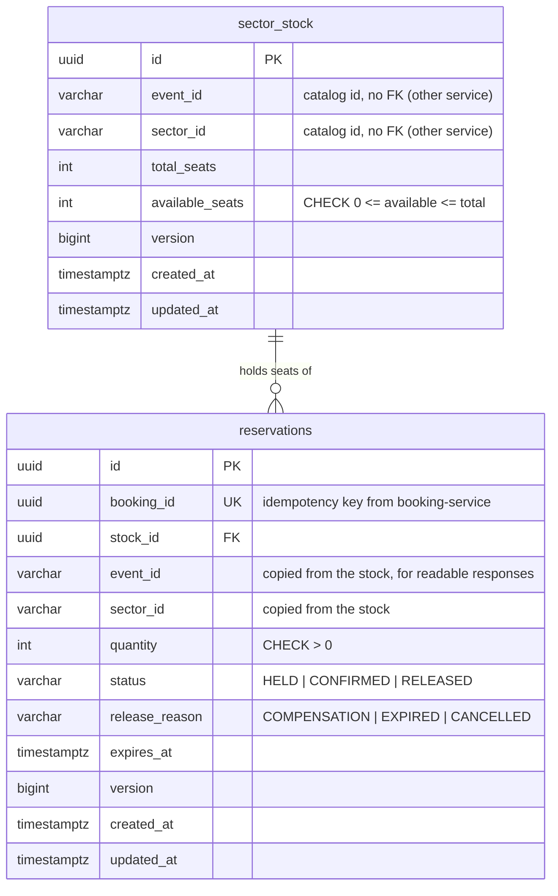
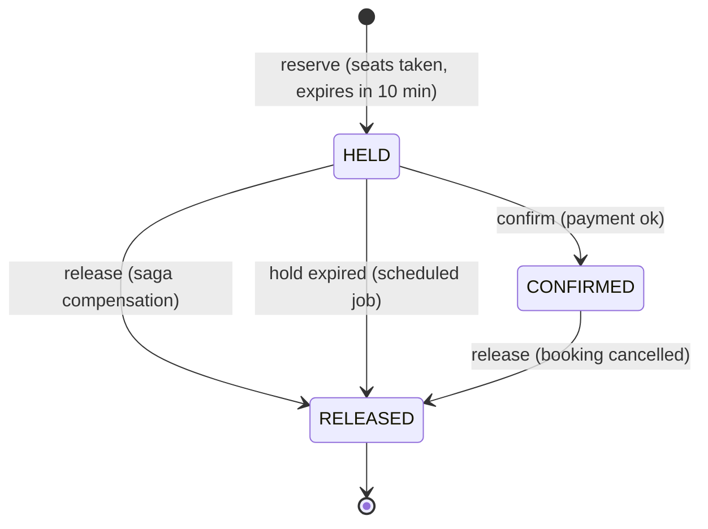
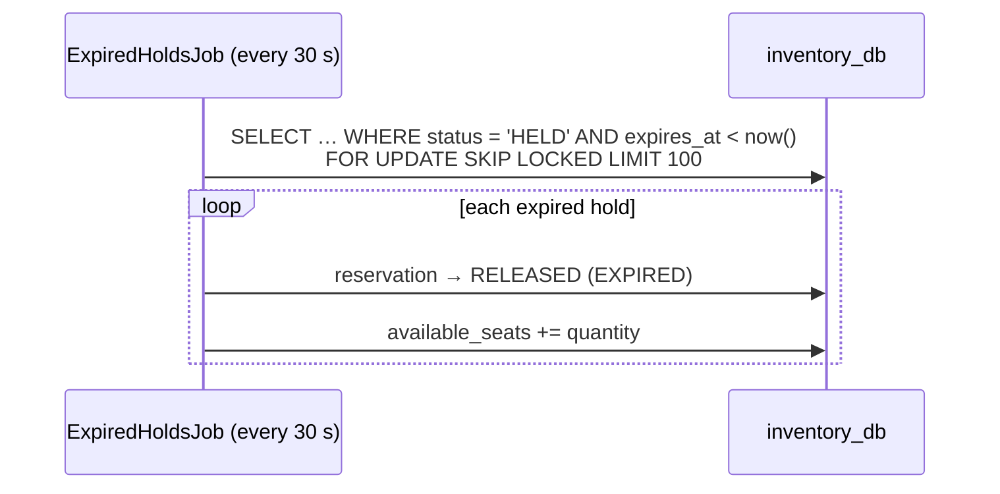
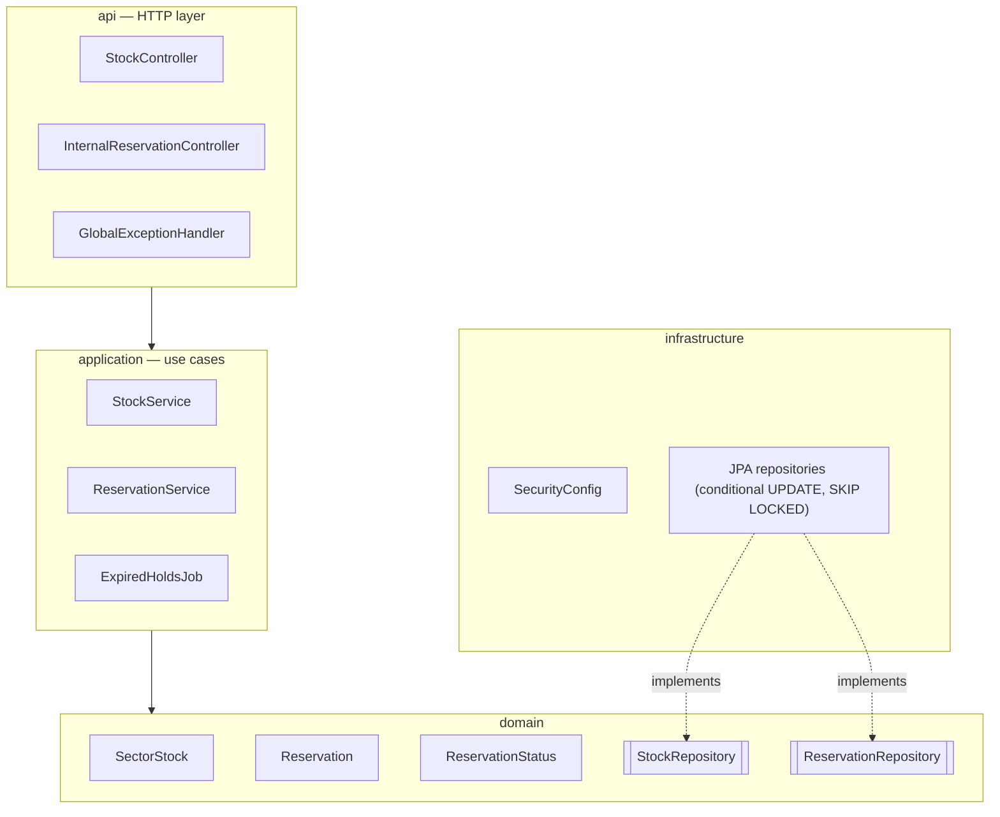

# inventory-service — Design (micro view)

Owns **how many seats are left** in each sector of each event, and who is holding them. Its one
hard promise: **a seat is never sold twice**, no matter how many bookings arrive at the same time.

## Responsibilities

- Admins set the number of seats of each sector (`eventId` + `sectorId` from the catalog).
- Anyone can see how many seats are still available.
- `booking-service` reserves seats (a temporary **hold**), then confirms or releases them as the saga
  goes on.
- Holds that are never confirmed expire on their own, so a crashed or slow orchestrator can't lock
  seats forever.

**Not** its job: prices, event details, or whether an event is on sale — that's the catalog, checked
by the orchestrator before it calls inventory. Inventory never calls another service.

## Tech

| Concern | Choice |
|---|---|
| Runtime | Java 21, Spring Boot 4.1.1 |
| Web | Spring Web MVC + Bean Validation |
| Persistence | Spring Data JPA + PostgreSQL `inventory_db`, schema via Flyway |
| Scheduling | Spring `@Scheduled` job for expired holds |
| Security | Spring Security resource server, same JWT secret as `auth-service` |
| Errors | RFC 9457 `ProblemDetail` |
| Tests | JUnit 5, Mockito, `@WebMvcTest`, Testcontainers (PostgreSQL), concurrency test |

## Why PostgreSQL here

This is the most write-heavy, consistency-critical part of the system. It needs real transactions,
row-level locking, `CHECK` constraints and unique constraints — the things a relational database
does best.

## Data model (`inventory_db`)



`sector_stock.version` is bumped by the seat-taking SQL too, not only by JPA. An admin resize
(read → change → save through the entity) therefore fails with `409` if a reservation changed the
row in the meantime, instead of silently overwriting the seat count.

- `UNIQUE (event_id, sector_id)` on `sector_stock`.
- `event_id` / `sector_id` / `booking_id` point to other services, so they are **plain columns,
  never foreign keys**. The only FK (`reservations.stock_id`) stays inside this service.

## How overselling is prevented

Taking seats is **one conditional `UPDATE`**, run inside the same transaction that inserts the
reservation:

```sql
UPDATE sector_stock
   SET available_seats = available_seats - :quantity, updated_at = now()
 WHERE id = :stockId
   AND available_seats >= :quantity;
```

- PostgreSQL locks the row while it updates it. Two concurrent bookings for the last seat: one
  updates 1 row, the other updates **0 rows** → "not enough seats" (`409`). There is no gap between
  "check" and "take".
- The `CHECK (available_seats >= 0)` constraint is a safety net: even a bug elsewhere can't make
  the number negative.
- Why not `SELECT … FOR UPDATE` then update in Java? It also works, but holds the lock across
  more round trips. The conditional update does the check and the write in one statement.
- Proven by a test: many threads try to book the last few seats at once; exactly the right number
  succeed and `available_seats` ends at 0.

## Reservation lifecycle



Releasing always gives the seats back to `available_seats`, in the same transaction.

## Idempotency — every saga call is safe to repeat

All internal operations are keyed by **`bookingId`**, not by the reservation id. This matters when
a call times out: the orchestrator may not know whether the reservation was created, but it always
knows its own `bookingId`.

| Call | First time | Repeated |
|---|---|---|
| reserve (`bookingId`, sector, qty) | creates `HELD`, `201` | returns the same reservation, `200` (no extra seats taken) |
| reserve with same `bookingId` but other sector/qty | — | `409` (conflicting reuse of the key) |
| confirm | `HELD → CONFIRMED` | already `CONFIRMED` → `200` |
| release | `HELD/CONFIRMED → RELEASED` | already `RELEASED` → `200`; unknown `bookingId` → `204` (nothing to undo) |

### The tricky case: hold expired before confirm

If payment takes longer than the hold, the scheduled job may already have released the seats. Then
**confirm fails with `409`**, and the orchestrator must compensate (refund the payment). The seats
may already belong to someone else, so confirm never "re-takes" them. A confirm that arrives after
`expires_at` but before the job ran is treated the same way: the hold is released and `409` is
returned.

## API

| Method | Path | Access | Description |
|---|---|---|---|
| `PUT` | `/api/inventory/events/{eventId}/sectors/{sectorId}` | `ADMIN` | Create or resize a sector's stock `{ "totalSeats": 500 }` |
| `GET` | `/api/inventory/events/{eventId}/sectors` | public | Availability of every sector of an event |
| `GET` | `/api/inventory/events/{eventId}/sectors/{sectorId}` | public | Availability of one sector |
| `POST` | `/internal/reservations` | authenticated | Reserve `{ bookingId, eventId, sectorId, quantity }` |
| `GET` | `/internal/reservations/booking/{bookingId}` | authenticated | Current reservation of a booking |
| `POST` | `/internal/reservations/booking/{bookingId}/confirm` | authenticated | Confirm the hold |
| `POST` | `/internal/reservations/booking/{bookingId}/release` | authenticated | Release (compensation or cancellation) |

Resizing never goes below the seats already taken: new `totalSeats` must be ≥ `total − available`,
otherwise `409`.

Reservation response:

```json
{
  "reservationId": "…", "bookingId": "…", "eventId": "…", "sectorId": "pista",
  "quantity": 2, "status": "HELD", "expiresAt": "2026-10-17T22:10:00Z"
}
```

### Errors

| Case | Status |
|---|---|
| Invalid body (quantity ≤ 0 or > 10, blank ids, totalSeats < 0) | `400` |
| No stock configured for that event/sector | `404` |
| Not enough seats | `409` (`title: "Not enough seats"`, with `available` in the body) |
| Confirm after the hold expired / was released | `409` |
| Same `bookingId` reused with different data | `409` |
| Resize below seats already taken | `409` |
| Missing token / not admin | `401` / `403` (admin routes checked before the body is read) |

Max 10 seats per booking — a simple anti-scalper rule, configurable.

## Expired holds job



`FOR UPDATE SKIP LOCKED` lets several instances run the job at once without releasing the same hold
twice, and without waiting on rows another transaction (e.g. a confirm) is using.

## Internal structure



Package root: `com.ticketflow.inventory`.

**SOLID in practice**
- *Single responsibility:* `ReservationService` runs the reservation state machine;
  `StockService` manages capacity; `ExpiredHoldsJob` only finds and releases expired holds (it reuses
  the same release logic).
- *Rich domain:* `Reservation` enforces its own transitions (`confirm(now)`, `release(reason)`), so
  an invalid transition is impossible from any caller.
- *Dependency inversion:* use cases depend on repository interfaces; the SQL that guarantees no
  overselling lives in the infrastructure layer.

## Configuration

| Env var | Default (local) | Purpose |
|---|---|---|
| `SERVER_PORT` | `8083` | HTTP port |
| `DB_URL` | `jdbc:postgresql://localhost:5432/inventory_db` | Database |
| `DB_USERNAME` / `DB_PASSWORD` | `inventory_user` / `inventory_pass` | Credentials (local only) |
| `HOLD_DURATION` | `10m` | How long a hold lasts |
| `EXPIRY_JOB_INTERVAL` | `30s` | How often expired holds are released |
| `MAX_SEATS_PER_BOOKING` | `10` | Anti-scalper limit |
| `JWT_SECRET` | none (dev value in `application-local.yml`) | Token validation |

## Tests

- **Unit:** `Reservation` transitions, `ReservationService` idempotency rules (Mockito, fixed clock).
- **Web slice:** validation, public vs admin vs internal access, error mapping.
- **Integration (PostgreSQL in Testcontainers):** reserve → confirm → release puts seats back;
  repeated calls change nothing; confirm after expiry → `409`; the job releases expired holds;
  resize below taken seats → `409`.
- **Concurrency:** 50 parallel reservations of 1 seat against 10 available → exactly 10 succeed,
  40 get `409`, `available_seats = 0`.

## Delivered with this service

- `inventory-service/` Maven project and `Dockerfile`
- `inventory_db` and its user added to `infra/postgres/init.sql`, service added to `docker-compose.yml`
- Seed script extended to set seat counts for the sample events

## Note for the saga docs

`booking-service` will call confirm/release **by `bookingId`** (not reservation id), as described
above. [booking-saga.md](../../docs/booking-saga.md) is updated accordingly.
