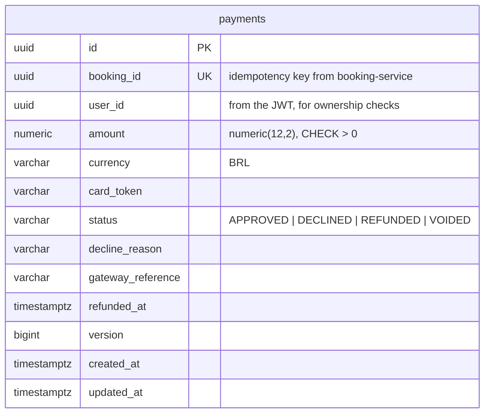
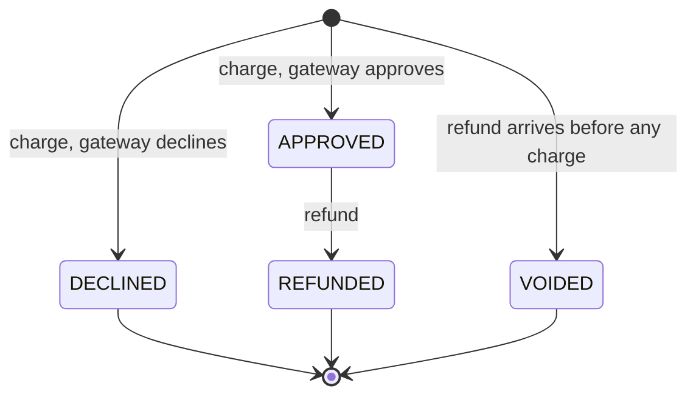
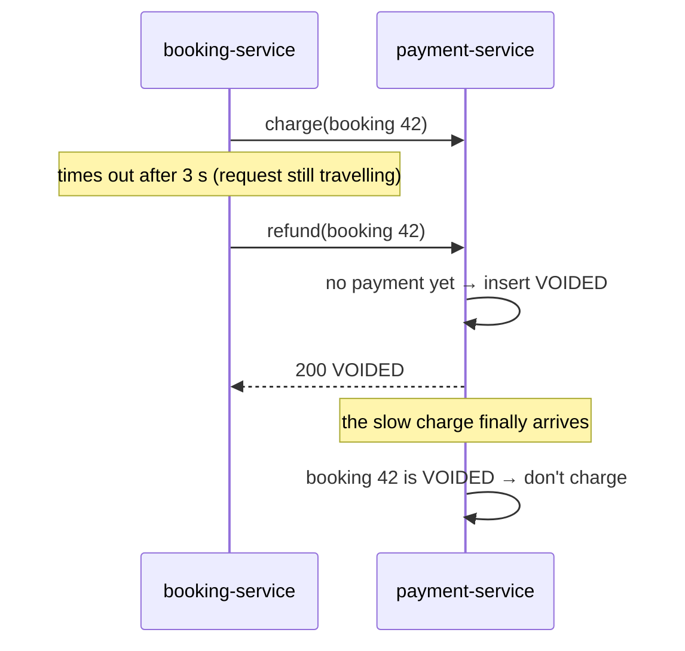
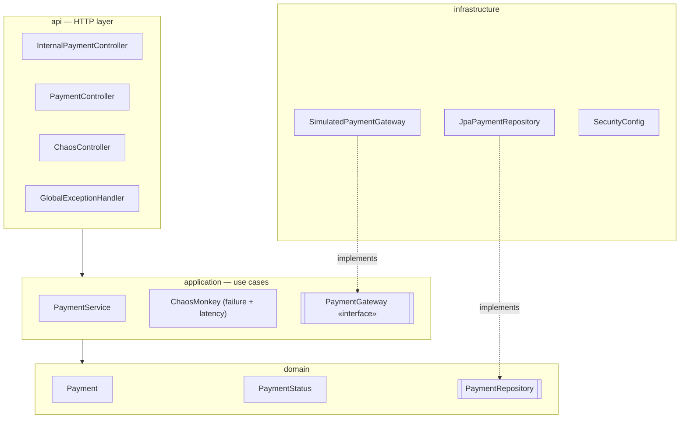

# payment-service — Design (micro view)

Owns **money**: charging a booking and refunding it. The card processor is simulated, but the
rules around it are the real ones: never charge twice, always be able to undo, and tell a
*business* failure (card declined) apart from a *technical* one (service down).

It also has a **chaos mode** an admin can switch on to make it slow or failing on purpose. That is
how the circuit breaker in `booking-service` gets demonstrated.

## Responsibilities

- Charge a booking (`bookingId`, amount, card token) through a payment gateway.
- Refund a booking — the saga's compensation step, or a cancellation.
- Let the owner of a payment (or an admin) look it up.
- Chaos mode: inject failures and latency into charges, on demand.

**Not** its job: knowing what was bought or for how much. The orchestrator sends the amount it
took from the catalog snapshot; payment trusts it and records it.

## Tech

| Concern | Choice |
|---|---|
| Runtime | Java 21, Spring Boot 4.1.1 |
| Web | Spring Web MVC + Bean Validation |
| Persistence | Spring Data JPA + PostgreSQL `payment_db`, schema via Flyway |
| Security | Spring Security resource server, same JWT secret as `auth-service` |
| Errors | RFC 9457 `ProblemDetail` |
| Tests | JUnit 5, Mockito, `@WebMvcTest`, Testcontainers (PostgreSQL), concurrency test |

## Business failure vs technical failure

This distinction is what lets the orchestrator's circuit breaker work correctly:

| What happened | HTTP | Payment row | Counts as failure for the circuit breaker? |
|---|---|---|---|
| Card approved | `201` | `APPROVED` | no |
| Card declined (insufficient funds, fraud, over limit) | `201` | `DECLINED` + reason | **no** — the service worked; the answer was "no" |
| Chaos / gateway unavailable | `503` | none written | **yes** |
| Too slow (chaos latency) | — (caller times out) | maybe written later | **yes** (time limiter) |

A declined card must never open the circuit: a hundred users with empty cards don't mean the
payment service is broken.

## Simulated gateway

`PaymentGateway` is an interface (the "port"); `SimulatedPaymentGateway` implements it with
deterministic rules, so demos and tests are repeatable:

| Card token | Result |
|---|---|
| `tok_declined` | `DECLINED` — insufficient funds |
| `tok_fraud` | `DECLINED` — suspected fraud |
| anything else | `APPROVED` |
| amount > 50 000.00 | `DECLINED` — over limit |

A real provider (Stripe, Pagar.me...) would be another implementation of the same interface;
nothing else would change.

## Data model (`payment_db`)



One row per booking (`UNIQUE (booking_id)`). `booking_id` and `user_id` belong to other services:
plain columns, no foreign keys. Amounts are `numeric(12,2)` in the database and `BigDecimal` in
Java — never floating point.

## Payment lifecycle



Only full refunds — a booking is refunded entirely or not at all.

## Idempotency — every saga call is safe to repeat

All internal operations are keyed by **`bookingId`**:

| Call | Payment state | Result |
|---|---|---|
| charge | none | gateway called, row created, `201` |
| charge (repeated, same amount) | any | the existing payment, `200` — **gateway not called again** |
| charge, same `bookingId`, different amount | any | `409` |
| charge | `VOIDED` | the `VOIDED` payment, `200` — **never charged** (see below) |
| refund | `APPROVED` | → `REFUNDED`, `200` |
| refund | `REFUNDED` / `DECLINED` / `VOIDED` | unchanged, `200` (nothing to give back) |
| refund | none | `VOIDED` row created, `200` |

### The tricky case: refund before charge

The orchestrator calls refund when the charge call **timed out** — it can't know whether money was
taken. If the charge request is still on its way (slow network, chaos latency), the refund may
arrive **first**. Without care, the late charge would then take money that is never returned.

So a refund for an unknown booking writes a **`VOIDED` tombstone**. When the late charge arrives, it
finds that row and returns it without calling the gateway.



### Serializing per booking

Every charge and refund of a booking runs inside a transaction that first takes a **PostgreSQL
advisory lock** keyed by the booking id (`pg_advisory_xact_lock`), then re-checks for an existing
payment. A normal row lock (`SELECT … FOR UPDATE`) wouldn't work here: before the first charge
there is no row to lock. With the advisory lock:

- 20 identical charges arriving together → one calls the gateway, the other 19 wait, then find
  its payment and return it. The card is charged **once**.
- A refund and a charge arriving together → whichever goes second sees the first one's result.

Retries skip all of this: a charge first looks for an existing payment without locking, and
returns it straight away (no chaos delay, no lock, no gateway). `UNIQUE (booking_id)` stays as
the last line of defence.

## Chaos mode

Admin-only switch, held in memory (per instance, reset on restart):

```http
PUT /api/payments/admin/chaos
{ "failureRate": 0.5, "latencyMs": 2000 }
```

- `failureRate` (0–1): share of **charges** that fail with `503` before anything is written.
- `latencyMs` (0–10 000): delay added to every charge — longer than the orchestrator's 3 s time
  limiter means timeouts.
- `GET` shows the current setting; `DELETE` turns it off.

Refunds are never affected: compensation must stay reliable while the demo breaks charges.

## API

| Method | Path | Access | Description |
|---|---|---|---|
| `POST` | `/internal/payments` | authenticated | Charge `{ bookingId, amount, currency, cardToken }` |
| `POST` | `/internal/payments/booking/{bookingId}/refund` | authenticated | Refund (or void) |
| `GET` | `/internal/payments/booking/{bookingId}` | authenticated | Current payment of a booking |
| `GET` | `/api/payments/booking/{bookingId}` | owner or `ADMIN` | User-facing lookup |
| `GET` / `PUT` / `DELETE` | `/api/payments/admin/chaos` | `ADMIN` | Chaos mode |

The user id stored with the payment is the `sub` of the token that made the charge. The
orchestrator forwards the user's token, so it is the user who booked. Another user asking for
that payment gets `404` (not `403`, so payment ids can't be probed).

Payment response:

```json
{
  "paymentId": "…", "bookingId": "…", "amount": 690.00, "currency": "BRL",
  "status": "DECLINED", "declineReason": "INSUFFICIENT_FUNDS",
  "gatewayReference": null, "createdAt": "…", "refundedAt": null
}
```

### Errors

| Case | Status |
|---|---|
| Invalid body (amount ≤ 0, more than 2 decimals, currency not BRL, blank token) | `400` |
| Same `bookingId` reused with a different amount | `409` |
| Chaos-injected failure | `503` |
| Payment not found / not yours | `404` |
| Missing token / not admin | `401` / `403` (admin routes checked before the body is read) |

## Internal structure



Package root: `com.ticketflow.payment`.

**SOLID in practice**
- *Dependency inversion / open-closed:* `PaymentService` depends on the `PaymentGateway`
  interface. Swapping the simulator for a real provider means writing one new class.
- *Single responsibility:* `ChaosMonkey` only injects faults; `PaymentService` doesn't know chaos
  exists beyond one call at the start of a charge.
- *Rich domain:* `Payment` owns its transitions (`refund(now)`, `isSameCharge(amount)`), so an
  invalid one (e.g. refunding a declined payment) can't happen anywhere.

## Configuration

| Env var | Default (local) | Purpose |
|---|---|---|
| `SERVER_PORT` | `8084` | HTTP port |
| `DB_URL` | `jdbc:postgresql://localhost:5432/payment_db` | Database |
| `DB_USERNAME` / `DB_PASSWORD` | `payment_user` / `payment_pass` | Credentials (local only) |
| `PAYMENT_LIMIT` | `50000.00` | Simulated per-charge limit |
| `JWT_SECRET` | none (dev value in `application-local.yml`) | Token validation |

## Tests

- **Unit:** gateway rules, `Payment` transitions, `PaymentService` idempotency and void rules,
  chaos failure/latency (Mockito, fixed clock).
- **Web slice:** validation, owner vs other user vs admin, chaos endpoints admin-only, error mapping.
- **Integration (PostgreSQL in Testcontainers):** charge → refund; repeated charge doesn't call the
  gateway again; declined payments; refund-before-charge voids the late charge; chaos `503` writes
  nothing.
- **Concurrency:** 20 parallel identical charges for one booking → the gateway is called once and
  one row exists.

## Delivered with this service

- `payment-service/` Maven project and `Dockerfile`
- `payment_db` and its user in `infra/postgres/init.sql`, service added to `docker-compose.yml`

## Note for the saga docs

[booking-saga.md](../../docs/booking-saga.md) gets the refund-before-charge (`VOIDED`) case, and
[resilience.md](../../docs/resilience.md) the chaos endpoint (`PUT`, not `POST`), and a note that a
declined card is not a circuit-breaker failure.
